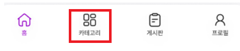

# 2-2 네비게이션 바 카테고리 클릭

[← 홈화면 리디자인 목록](README.md)

플랫폼: ANDROID, IOS, WEB (모바일)  
원문 상태: 완료  
[Notion 기준 명세](https://app.notion.com/p/eb80221954bc837a94aa81ae2d1fddaf)  
원본 ID: `eb80221954bc837a94aa81ae2d1fddaf`

<!-- notion-body:start -->
## 과거 로깅

- event\_label : nav\_category
- value : 카테고리
- event\_category : click



## 새 로깅

<b>카테고리</b>

- 설명: 공용 하단 네비게이션 바에서 카테고리 항목을 눌러 카테고리 메뉴를 열 때 기록한다. 메뉴 내부 서비스 클릭과 구분한다.
- screen\_view: <code>main</code>
- event\_name: <code>DA2</code>
- event\_label: <code>main__main__navigation__category_menu_entry__click</code>
- value: 카테고리
- event\_category: <code>click</code>
<!-- notion-body:end -->

<details>
<summary>Notion 원문 속성 전체</summary>

```json
{
  "platform": [
    "ANDROID",
    "IOS",
    "WEB (모바일)"
  ],
  "url": "https://app.notion.com/p/eb80221954bc837a94aa81ae2d1fddaf",
  "구분": "네비게이션 바",
  "상태": "완료",
  "생성일": "2026-11-23T13:38:50.576Z",
  "이벤트 이름": "2-2 네비게이션 바 카테고리 클릭"
}
```

</details>
