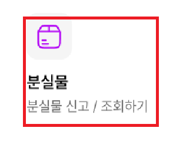

# 3-2 분실물 클릭 (과거 로깅) 2026.08.30 이후 로깅 중단

[← 홈화면 리디자인 로깅 목록](README.md)

플랫폼: ANDROID · IOS · WEB  
원문 상태: 완료

원문에 과거·새 로깅 구분이 없어 아래 정의와 참고사진을 원문 순서로 표시합니다.

원문 미기재 항목: `event_name`, `screen_view`. 값을 추정하지 않았습니다.

- event\_label : category\_lost\_property
- value : 분실물
- event\_category : click

---

원문 정보

원본 ID: `c250221954bc829b8abc0108f5d894d9`  
[보존 원문](../../_archive/original/notion/pages/c250221954bc829b8abc0108f5d894d9.md)

