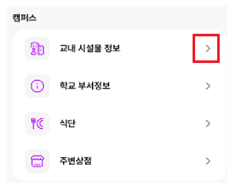

# 3-3 캠퍼스 부분 세부기능 클릭 (과거 로깅) 2026.08.30 이후 로깅 중단

[← 홈화면 리디자인 로깅 목록](README.md)

플랫폼: ANDROID · IOS · WEB  
원문 상태: 완료

원문에 과거·새 로깅 구분이 없어 아래 정의와 참고사진을 원문 순서로 표시합니다.

원문 미기재 항목: `event_name`, `screen_view`. 값을 추정하지 않았습니다.

- event\_label : category\_campus
- value : \{교내 시설물 정보\} or \{학교 부서정보\} or \{식단\} or \{주변상점\}
- event\_category : click

---

원문 정보

원본 ID: `ea70221954bc827f802181dc9cfb103c`  
[보존 원문](../../_archive/original/notion/pages/ea70221954bc827f802181dc9cfb103c.md)

