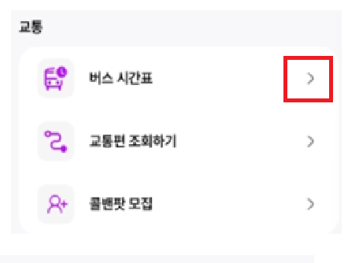

# 3-4 교통 부분 세부기능 클릭 (과거 로깅) 2026.08.30 이후 로깅 중단

[← 홈화면 리디자인 목록](README.md)

플랫폼: ANDROID, IOS, WEB  
원문 상태: 완료  
[Notion 기준 명세](https://app.notion.com/p/38e0221954bc83288ed901f62ce45614)  
원본 ID: `38e0221954bc83288ed901f62ce45614`

<!-- notion-body:start -->
- event\_label : category\_transportation
- value : \{버스 시간표\} or \{교통편 조회하기\} or \{콜밴팟 모집\}
- event\_category : click


<!-- notion-body:end -->

<details>
<summary>Notion 원문 속성 전체</summary>

```json
{
  "platform": [
    "ANDROID",
    "IOS",
    "WEB"
  ],
  "url": "https://app.notion.com/p/38e0221954bc83288ed901f62ce45614",
  "상태": "완료",
  "생성일": "2026-11-23T13:38:48.329Z",
  "이벤트 이름": "3-4 교통 부분 세부기능 클릭 (과거 로깅) 2026.08.30 이후 로깅 중단"
}
```

</details>
