# 3-6 카테고리 내부 클릭 (현재 로깅) 2026.08.30 이후 찍히는 로깅

[← 홈화면 리디자인 목록](README.md)

플랫폼: ANDROID, IOS, WEB (모바일)  
원문 상태: 완료  
[Notion 기준 명세](https://app.notion.com/p/ea70221954bc837d824b81d034d72403)  
원본 ID: `ea70221954bc837d824b81d034d72403`

<!-- notion-body:start -->
## 과거 로깅

① 팀원 모집

- event\_label : category\_team\_recruitment
- value : 팀원 모집
- event\_category : click

② 분실물

- event\_label : category\_lost\_and\_found
- value : 분실물
- event\_category : click

③ 교내 시설물 정보

- event\_label : category\_facility
- value : 교내 시설물 정보
- event\_category : click

④ 학교 부서 정보

- event\_label : category\_department
- value : 학교 부서 정보
- event\_category : click

⑤ 식단

- event\_label : category\_dining
- value : 식단
- event\_category : click

⑥ 주변상점

- event\_label : category\_nearby\_store
- value : 주변상점
- event\_category : click

⑦ 시간표

- event\_label : category\_timetable
- value : 시간표
- event\_category : click

⑧ 버스 시간표

- event\_label : category\_bus\_timetable
- value : 버스 시간표
- event\_category : click

⑨ 교통편 조회하기

- event\_label : category\_transportation
- value : 교통편 조회하기
- event\_category : click

⑩ 콜벤팟 모집

- event\_label : category\_callvan\_recruitment
- value : 콜벤팟 모집
- event\_category : click

⑪ 채팅

- event\_label : category\_chat
- value : 채팅
- event\_category : click

⑫ 복덕방

- event\_label : category\_room
- value : 복덕방
- event\_category : click

⑬ 코인 for Business

- event\_label : category\_koin\_for\_business
- value : 코인 for Business
- event\_category : click

## 새 로깅

<b>① 팀원 모집</b>

- 설명: 공용 카테고리 메뉴에서 팀원 모집 항목을 클릭해 해당 화면으로 진입할 때 한 번 기록한다.
- screen\_view: <code>main_category</code>
- event\_name: <code>DA1</code>
- event\_label: <code>team_recruit__main_category__category_navigation__team_recruit_entry__click</code>
- value: 팀원 모집
- event\_category: <code>click</code>

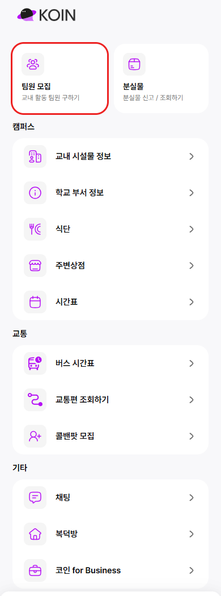

<b>② 분실물</b>

- 설명: 공용 카테고리 메뉴에서 분실물 항목을 클릭해 해당 화면으로 진입할 때 한 번 기록한다.
- screen\_view: <code>main_category</code>
- event\_name: <code>DA2</code>
- event\_label: <code>board__main_category__category_navigation__lost_item_entry__click</code>
- value: 분실물
- event\_category: <code>click</code>

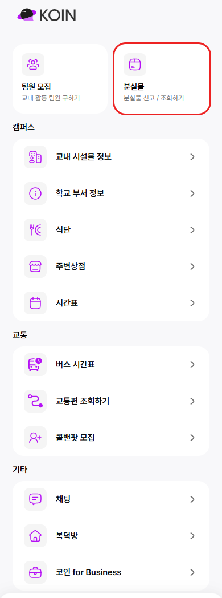

<b>③ 교내 시설물 정보</b>

- 설명: 카테고리의 교내 시설물 정보 메뉴를 클릭해 해당 화면으로 진입할 때 기록한다.
- screen\_view: <code>main_category</code>
- event\_name: <code>DA2</code>
- event\_label: <code>facility__main_category__category_navigation__facility_entry__click</code>
- value: 교내 시설물 정보
- event\_category: <code>click</code>

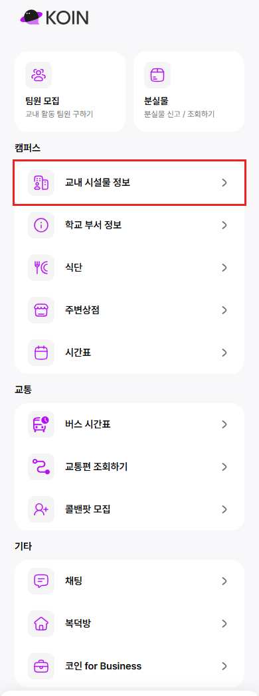

<b>④ 학교 부서 정보</b>

- 설명: 카테고리의 학교 부서 정보 메뉴를 클릭해 해당 화면으로 진입할 때 기록한다.
- screen\_view: <code>main_category</code>
- event\_name: <code>DA2</code>
- event\_label: <code>department__main_category__category_navigation__department_entry__click</code>
- value: 학교 부서 정보
- event\_category: <code>click</code>

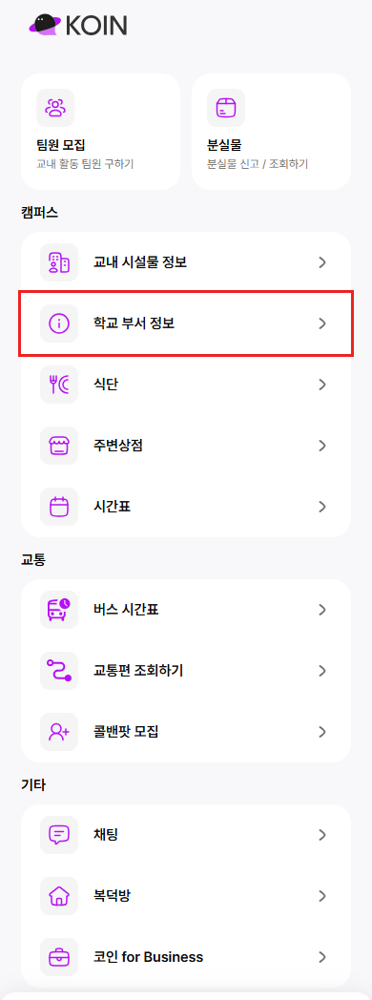

<b>⑤ 식단</b>

- 설명: 카테고리의 식단 메뉴를 클릭해 해당 화면으로 진입할 때 기록한다.
- screen\_view: <code>main_category</code>
- event\_name: <code>DA1</code>
- event\_label: <code>cafeteria__main_category__category_navigation__cafeteria_entry__click</code>
- value: 식단
- event\_category: <code>click</code>

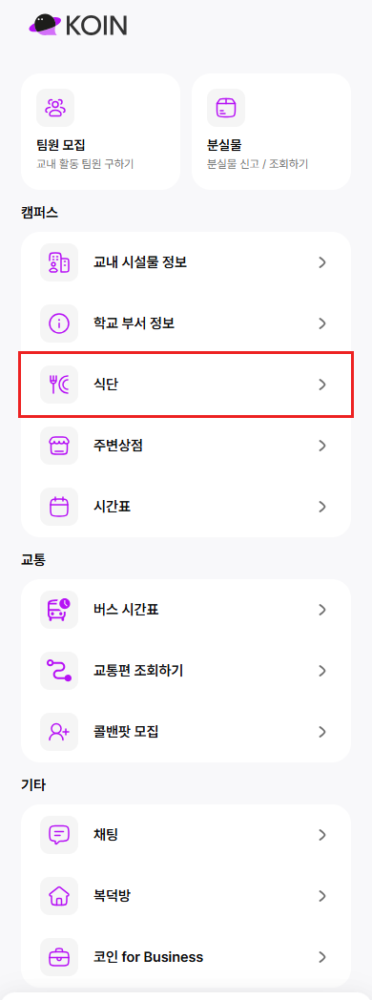

<b>⑥ 주변상점</b>

- 설명: 공용 카테고리 메뉴에서 주변상점 항목을 클릭해 해당 화면으로 진입할 때 한 번 기록한다.
- screen\_view: <code>main_category</code>
- event\_name: <code>DA1</code>
- event\_label: <code>shop__main_category__category_navigation__shop_entry__click</code>
- value: 주변상점
- event\_category: <code>click</code>

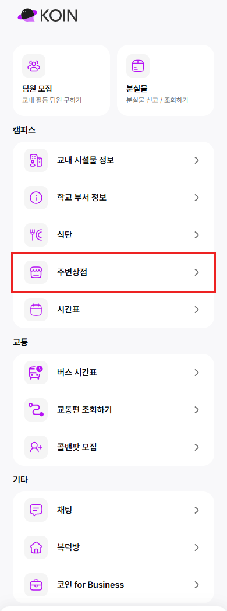

<b>⑦ 시간표</b>

- 설명: 공용 카테고리 메뉴에서 시간표 항목을 클릭해 해당 화면으로 진입할 때 한 번 기록한다.
- screen\_view: <code>main_category</code>
- event\_name: <code>DA1</code>
- event\_label: <code>timetable__main_category__category_navigation__timetable_entry__click</code>
- value: 시간표
- event\_category: <code>click</code>

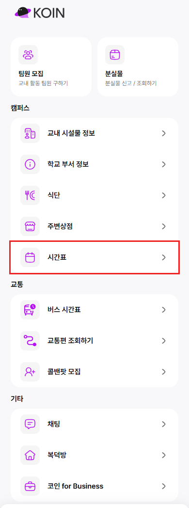

<b>⑧ 버스 시간표</b>

- 설명: 카테고리의 버스 시간표 메뉴를 클릭해 해당 화면으로 진입할 때 기록한다.
- screen\_view: <code>main_category</code>
- event\_name: <code>DA1</code>
- event\_label: <code>bus__main_category__category_navigation__timetable_entry__click</code>
- value: 버스 시간표
- event\_category: <code>click</code>

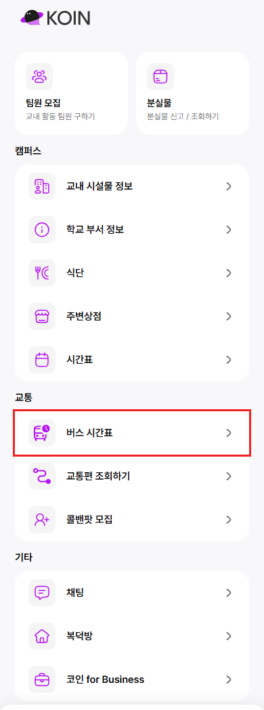

<b>⑨ 교통편 조회하기</b>

- 설명: 카테고리의 교통편 조회하기 메뉴를 클릭해 해당 화면으로 진입할 때 기록한다.
- screen\_view: <code>main_category</code>
- event\_name: <code>DA1</code>
- event\_label: <code>bus__main_category__category_navigation__search_entry__click</code>
- value: 교통편 조회하기
- event\_category: <code>click</code>

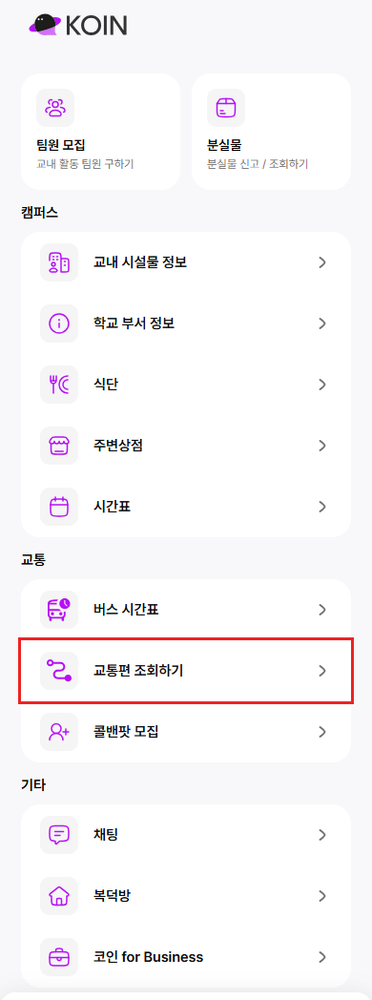

<b>⑩ 콜밴팟 모집</b>

- 설명: 카테고리의 콜밴팟 모집 메뉴를 클릭해 해당 화면으로 진입할 때 기록한다.
- screen\_view: <code>main_category</code>
- event\_name: <code>DA2</code>
- event\_label: <code>callvan__main_category__category_navigation__callvan_entry__click</code>
- value: 콜벤팟 모집
- event\_category: <code>click</code>

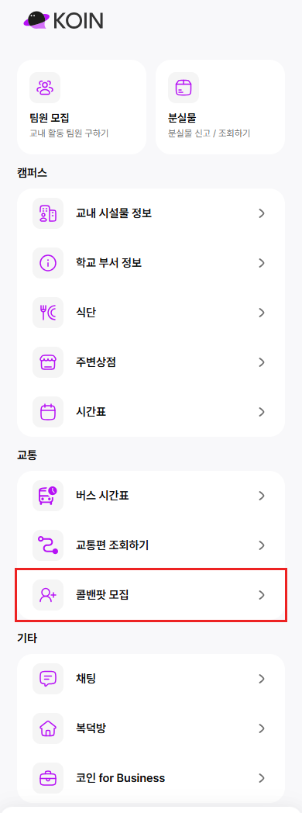

<b>⑪ 채팅</b>

- 설명: 카테고리의 채팅 메뉴를 클릭해 해당 화면으로 진입할 때 기록한다.
- screen\_view: <code>main_category</code>
- event\_name: <code>DA2</code>
- event\_label: <code>chat__main_category__category_navigation__chat_entry__click</code>
- value: 채팅
- event\_category: <code>click</code>

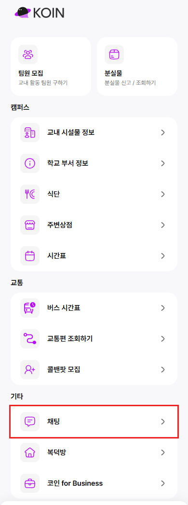

<b>⑫ 복덕방</b>

- 설명: 공용 카테고리 메뉴에서 복덕방 항목을 클릭해 해당 화면으로 진입할 때 한 번 기록한다.
- screen\_view: <code>main_category</code>
- event\_name: <code>DA1</code>
- event\_label: <code>real_estate__main_category__category_navigation__real_estate_entry__click</code>
- value: 복덕방
- event\_category: <code>click</code>

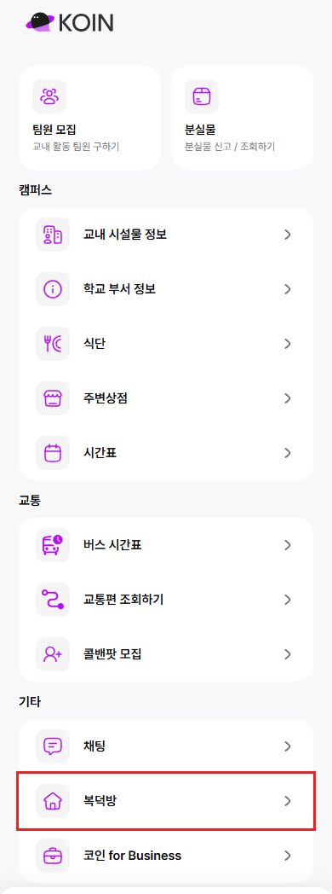

<b>⑬ 코인 for Business</b>

- 설명: 카테고리의 코인 for Business 메뉴를 클릭해 외부 사장님 사이트로 이동을 시도할 때 기록한다.
- screen\_view: <code>main_category</code>
- event\_name: <code>DA1</code>
- event\_label: <code>owner__main_category__category_navigation__owner_entry__click</code>
- value: 코인 for Business
- event\_category: <code>click</code>

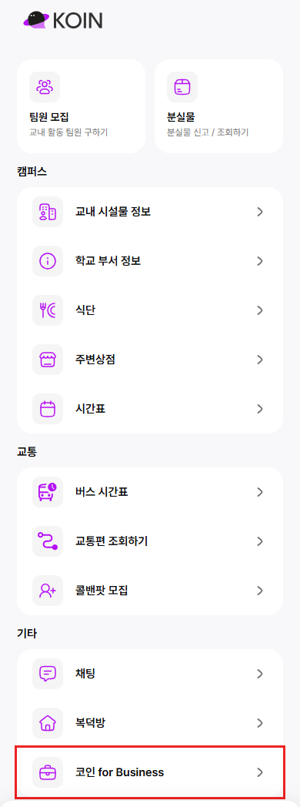
<!-- notion-body:end -->

<details>
<summary>Notion 원문 속성 전체</summary>

```json
{
  "platform": [
    "ANDROID",
    "IOS",
    "WEB (모바일)"
  ],
  "url": "https://app.notion.com/p/ea70221954bc837d824b81d034d72403",
  "구분": "카테고리",
  "상태": "완료",
  "생성일": "2026-11-23T13:38:49.996Z",
  "이벤트 이름": "3-6 카테고리 내부 클릭 (현재 로깅) 2026.08.30 이후 찍히는 로깅"
}
```

</details>
