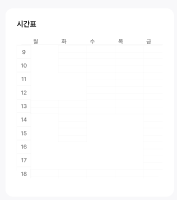
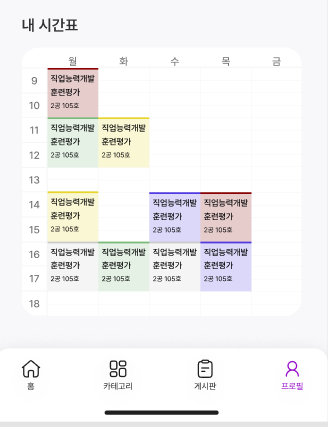

# 4-1 내 시간표 클릭

[← 홈화면 리디자인 목록](README.md)

플랫폼: ANDROID, IOS, WEB (모바일)  
원문 상태: 완료  
[Notion 기준 명세](https://app.notion.com/p/9480221954bc8373976081128db48fe4)  
원본 ID: `9480221954bc8373976081128db48fe4`

<!-- notion-body:start -->
## 과거 로깅

- event\_label : home\_timetable
- value : 내 시간표
- event\_category : click

## 새 로깅

<b>내 시간표</b>

- 설명: 프로필 화면의 내 시간표 버튼을 클릭할 때 기록한다. 카테고리·헤더·푸터 시간표 진입과 구분한다.
- screen\_view: <code>main_profile</code>
- event\_name: <code>DA1</code>
- event\_label: <code>timetable__main_profile__timetable_entry__entry__click</code>
- value: 내 시간표
- event\_category: <code>click</code>

### 참고사진 (WEB PC 홈 시간표 위젯 · 별도 명세 연결)

<b>웹</b>

<b>참고사진 · 웹</b>

사용자 제공 WEB 리디자인 시간표 위젯 참고사진이다. 프로필의 ‘내 시간표’와 발생 위치가 다르므로 이 페이지의 <code>main_profile</code> 계약을 적용하지 않는다. 2026-11-28 PC 홈 계약을 별도로 작성했다. 제목 클릭은 [1-14 PC 홈 시간표 제목 클릭](https://app.notion.com/p/4250221954bc810f9793d1c2659c9dfa), 위젯 본문 클릭은 [1-15 PC 홈 시간표 위젯 본문 클릭](https://app.notion.com/p/4250221954bc818ba87dff2bbcf8d6a2)을 따른다. 새 명세에는 실제 Stage 화면의 클릭 위치를 빨간 네모로 표시했다. 명세 추가는 SDK 수정·배포·실수집 검수 완료를 뜻하지 않는다.



<b>모바일</b>

<b>참고사진 · 모바일</b>


<!-- notion-body:end -->

<details>
<summary>Notion 원문 속성 전체</summary>

```json
{
  "platform": [
    "ANDROID",
    "IOS",
    "WEB (모바일)"
  ],
  "url": "https://app.notion.com/p/9480221954bc8373976081128db48fe4",
  "구분": "프로필",
  "상태": "완료",
  "생성일": "2026-11-23T13:38:50.076Z",
  "이벤트 이름": "4-1 내 시간표 클릭"
}
```

</details>
