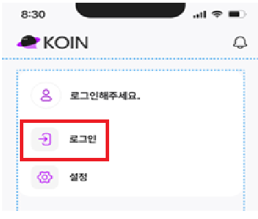
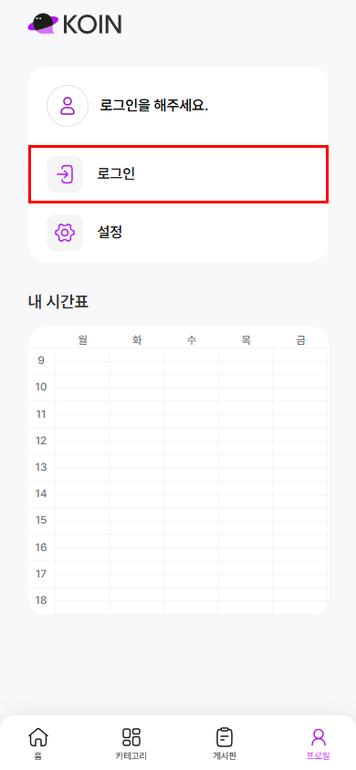

# 4-2 로그인 클릭

[← 홈화면 리디자인 로깅 목록](README.md)

플랫폼: ANDROID · IOS  
원문 상태: 완료

과거 로깅·새 로깅과 각 참고사진은 원문의 구간별 연결을 유지합니다.

<!-- logging-section:past:start -->
## 과거 로깅

- event\_label : home\_login
- value : 로그인
- event\_category : click

<!-- logging-section:past:end -->

<!-- logging-section:new:start -->
## 새 로깅

- screen\_view: <code>main_profile</code>
- event\_name: <code>DA2</code>
- event\_label: <code>account__main_profile__login__entry__click</code>
- value: 로그인
- event\_category: <code>click</code>
- 설명: 프로필 화면의 로그인 버튼을 클릭하여 로그인 화면으로 이동할 때 전송한다. 로그인 성공 이벤트가 아니다.

### 참고사진 (로그인 버튼 클릭)

WEB 헤더 사진은 [2-1 헤더_로그인 진입(클릭)](../15-%EB%A1%9C%EA%B7%B8%EC%9D%B8-%ED%9A%8C%EC%9B%90%EA%B0%80%EC%9E%85-%EC%A0%95%EB%B3%B4%EC%88%98%EC%A0%95-V2/2-1-%ED%97%A4%EB%8D%94_%EB%A1%9C%EA%B7%B8%EC%9D%B8-%EC%A7%84%EC%9E%85%28%ED%81%B4%EB%A6%AD%29.md)의 참고사진에서 확인한다. 이 페이지는 APP 프로필 main\_profile 명세이며 WEB 헤더와 구분한다. 동일 WEB 사진의 중복 첨부를 정리했고 모바일 사진과 기존 필드는 유지했다.

#### 모바일

모바일 웹 · 2026-10-30 운영 [koreatech.in/profile의](http://koreatech.in/profile%EC%9D%98) 보라색 실제 프로필 화면. 빨간 테두리=로그인 버튼. 로그인 실행 전 위치 참고사진이며 네이티브 앱과 SDK 발화는 미확인이다.

<!-- logging-section:new:end -->

---

원문 정보

원본 ID: `50c0221954bc8211862701c53ee682cd`  
[보존 원문](../../_archive/original/notion/pages/50c0221954bc8211862701c53ee682cd.md)

