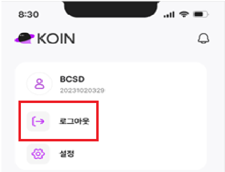
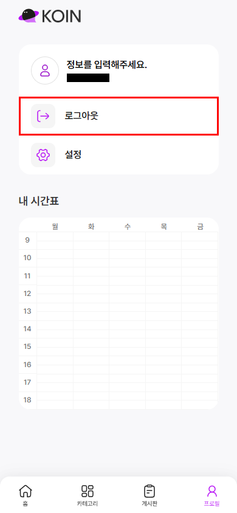

# 4-3 로그아웃 클릭

[← 홈화면 리디자인 목록](README.md)

플랫폼: ANDROID, IOS  
원문 상태: 완료  
[Notion 기준 명세](https://app.notion.com/p/8380221954bc839b835b819e6eecff8d)  
원본 ID: `8380221954bc839b835b819e6eecff8d`

<!-- notion-body:start -->
## 과거 로깅

- event\_label : home\_logout
- value : 로그아웃
- event\_category : click



## 새 로깅

- screen\_view: <code>main_profile</code>
- event\_name: <code>DA2</code>
- event\_label: <code>account__main_profile__logout__click</code>
- value: 로그아웃
- event\_category: <code>click</code>
- 설명: 프로필 화면의 로그아웃 버튼 클릭 시 전송한다. 로그아웃 처리 성공 이벤트를 추가하지 않는다.

### 참고사진 (로그아웃 버튼 클릭)

<b>웹</b>

<b>참고사진 · 웹 — 대표 명세 참조</b>

WEB 헤더 사진은 [4-1 로그아웃(클릭)](https://app.notion.com/p/ba70221954bc828a83e001ea56e7c3ef)의 참고사진에서 확인한다. 이 페이지는 APP 프로필 main\_profile 명세이며 WEB 헤더와 구분한다. 동일 WEB 사진의 중복 첨부를 정리했고 모바일 사진과 기존 필드는 유지했다.

<b>모바일</b>

<b>참고사진 · 모바일</b>


모바일 웹 · 2026-10-30 [stage.koreatech.in/profile의](http://stage.koreatech.in/profile%EC%9D%98) 보라색 실제 로그인 상태 프로필 화면. 빨간 테두리=로그아웃 버튼. 계정 식별 정보는 검은색 마스킹. 실제 로그아웃은 수행하지 않았으며 네이티브 앱과 SDK 발화는 미확인이다.
<!-- notion-body:end -->

<details>
<summary>Notion 원문 속성 전체</summary>

```json
{
  "platform": [
    "ANDROID",
    "IOS"
  ],
  "url": "https://app.notion.com/p/8380221954bc839b835b819e6eecff8d",
  "구분": "프로필",
  "상태": "완료",
  "생성일": "2026-11-23T13:38:50.339Z",
  "이벤트 이름": "4-3 로그아웃 클릭"
}
```

</details>
