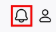

# 1-4 콜밴팟 알림 아이콘 클릭

[← 콜밴팟 로깅 목록](README.md)

플랫폼: ANDROID  
원문 상태: 로깅 필요

과거 로깅·새 로깅과 각 참고사진은 원문의 구간별 연결을 유지합니다.

<!-- logging-section:past:start -->
## 과거 로깅

- 확인한 Android 코드 스냅샷(2026-11-08)에서 해당 동작의 기존 이벤트 전송은 확인되지 않았다. iOS·WEB 기존 전송 여부는 미확인이다.

<!-- logging-section:past:end -->

<!-- logging-section:new:start -->
## 새 로깅

- 설명: 콜밴팟 목록 오른쪽 위 알림 아이콘을 클릭해 콜밴팟 전용 알림 화면으로 이동을 시도할 때 1회 기록한다.
- screen\_view: <code>callvan_list</code>
- event\_name: <code>DA2</code>
- event\_label: <code>callvan__callvan_list__notification_list__entry__click</code>
- value: 알림 아이콘
- event\_category: <code>click</code>

검토사항

- 상세 화면의 같은 아이콘은 이 계약에 섞지 않는다. 발생 화면은 callvan\_list이며 앱 공용 홈 main이 아니다.
- ANDROID·IOS·WEB에서 같은 기능은 같은 event\_label·screen\_view·event\_name을 사용한다. Android 동작만 저장 코드에서 확인했으므로 platform은 ANDROID로 등록했다. iOS·PC 웹·모바일 웹 지원은 미확인이며, 지원 확인 후 동일 계약으로 추가한다.
- 콜밴팟 전용 알림 계약이다. main의 공용 알림 및 team\_recruit 알림과 별개이며 한 클릭에 중복 전송하지 않는다.
- 명세 추가일: 2026-11-12. SDK 구현·배포·실수집·Silver 매핑 반영 완료를 뜻하지 않는다.
- 근거: 저장된 Android feature/callvan의 CallvanListScreen.kt, CallvanNotificationsScreen.kt, CallvanNotificationsViewModel.kt, CallvanConfirmBottomSheet.kt. 최신 원격 코드와 실기기 검수는 별도다.

<!-- logging-section:new:end -->

### 참고사진 (1-4 콜밴팟 알림 아이콘 클릭)

#### 웹 (모바일 웹)

#### 모바일

---

원문 정보

원본 ID: `56a0221954bc83e28c2281f565b67da6`  
[보존 원문](../../_archive/original/notion/pages/56a0221954bc83e28c2281f565b67da6.md)

