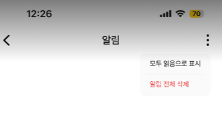

# 1-6 콜밴팟 알림 전체 삭제 메뉴 클릭

[← 콜밴팟 목록](README.md)

플랫폼: ANDROID, IOS  
원문 상태: 로깅 필요  
[Notion 기준 명세](https://app.notion.com/p/5d90221954bc8310977681b1bacd631a)  
원본 ID: `5d90221954bc8310977681b1bacd631a`

<!-- notion-body:start -->
## 과거 로깅

- 확인한 Android 코드 스냅샷(2026-11-08)에서 해당 동작의 기존 이벤트 전송은 확인되지 않았다. iOS·WEB 기존 전송 여부는 미확인이다.

## 새 로깅

- 설명: 더보기 메뉴에서 알림 전체 삭제를 클릭해 삭제 확인창을 열 때 1회 기록한다.
- screen\_view: <code>callvan_notification</code>
- event\_name: <code>DA2</code>
- event\_label: <code>callvan__callvan_notification__notification_list__delete_all_open__click</code>
- value: 알림 전체 삭제
- event\_category: <code>click</code>

## 검토사항

- 삭제 실행·성공과 구분한다. 확인창의 예 버튼은 별도 delete\_all\_confirm 계약이다.
- ANDROID·IOS에서 같은 기능은 같은 event\_label·screen\_view·event\_name을 사용한다. 2026-11-27 사용자 확인에 따라 이 계약의 지원 플랫폼은 ANDROID·IOS로 등록한다. Stage iOS 5.2.6의 2026-11-26 수집에서 동일 label·screen\_view·event\_name·category·value를 확인했다. PC 웹·모바일 웹 지원은 미확인이며, WEB은 추가하지 않는다.
- 콜밴팟 전용 알림 계약이다. main의 공용 알림 및 team\_recruit 알림과 별개이며 한 클릭에 중복 전송하지 않는다.
- 명세 추가일: 2026-11-12. SDK 구현·배포·실수집·Silver 매핑 반영 완료를 뜻하지 않는다.
- 근거: 저장된 Android feature/callvan의 CallvanListScreen.kt, CallvanNotificationsScreen.kt, CallvanNotificationsViewModel.kt, CallvanConfirmBottomSheet.kt. 최신 원격 코드와 실기기 검수는 별도다.

### 참고사진 (1-8 콜밴팟 알림 전체 삭제 메뉴 클릭)

<b>웹</b>

<b>참고사진 · 웹 (모바일 웹)</b>



<b>모바일</b>

<b>참고사진 · 모바일</b>


<!-- notion-body:end -->

<details>
<summary>Notion 원문 속성 전체</summary>

```json
{
  "platform": [
    "ANDROID",
    "IOS"
  ],
  "url": "https://app.notion.com/p/5d90221954bc8310977681b1bacd631a",
  "상태": "로깅 필요",
  "이름": "1-6 콜밴팟 알림 전체 삭제 메뉴 클릭",
  "태그": [
    "1. 메인 -> 콜밴팟"
  ]
}
```

</details>
