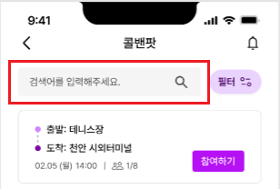
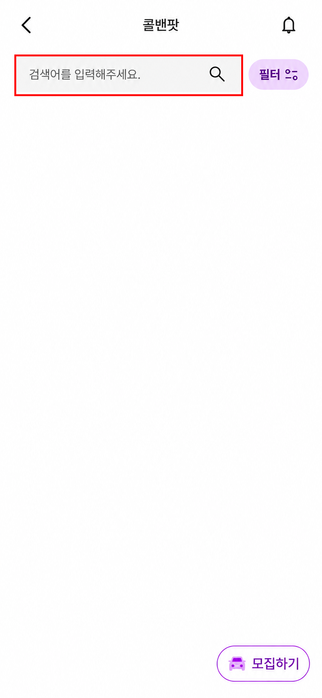

# 2-1 콜밴팟 검색바 클릭

[← 콜밴팟 목록](README.md)

플랫폼: ANDROID, IOS  
원문 상태: 로깅 필요  
[Notion 기준 명세](https://app.notion.com/p/7770221954bc826a864201306b07869e)  
원본 ID: `7770221954bc826a864201306b07869e`

<!-- notion-body:start -->
## 과거 로깅

- event\_name : CAMPUS
- event\_category : click
- event\_label : callvan\_search
- value :



## 새 로깅

- 설명: 콜밴팟 목록에서 검색 입력 영역을 클릭한다.
- screen\_view: <code>callvan_list</code>
- event\_label: <code>callvan__callvan_list__search__search_input__click</code>
- event\_name: <code>DA2</code>
- value: 기존 미기재 유지
- event\_category: <code>click</code>

### 참고사진 (기능 표시)

<b>모바일 (ANDROID, IOS) / 캡처 출처는 아래 참조</b>

<b>참고사진 · 모바일</b>

화면 정의의 Android 실제 캡처(2026-10-13), 선명도 개선본. 이번 작업은 기존 캡처를 사용.


<!-- notion-body:end -->

<details>
<summary>Notion 원문 속성 전체</summary>

```json
{
  "platform": [
    "ANDROID",
    "IOS"
  ],
  "url": "https://app.notion.com/p/7770221954bc826a864201306b07869e",
  "상태": "로깅 필요",
  "이름": "2-1 콜밴팟 검색바 클릭",
  "태그": [
    "2. 콜밴팟 찾기"
  ]
}
```

</details>
