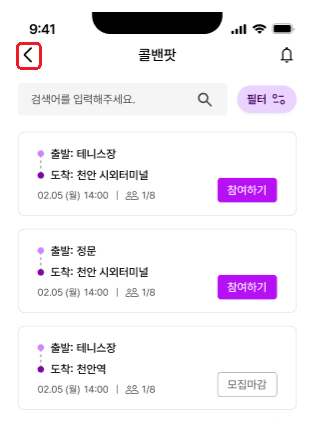
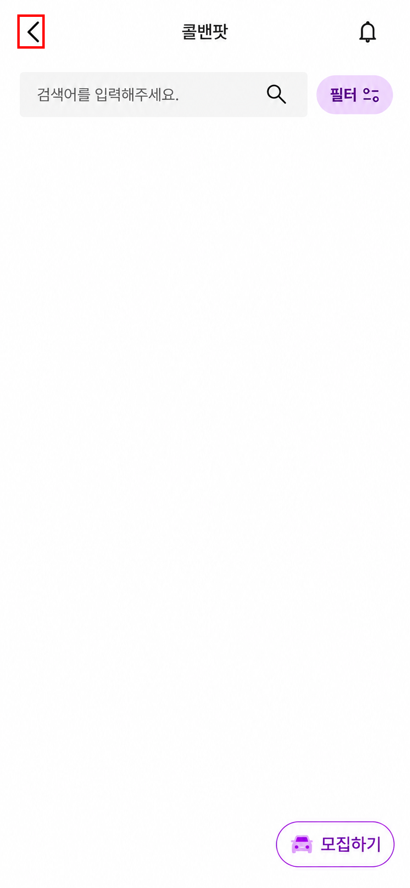

# 2-11  콜밴팟 찾기 이탈

[← 콜밴팟 목록](README.md)

플랫폼: ANDROID, IOS, WEB (모바일)  
원문 상태: 로깅 필요  
[Notion 기준 명세](https://app.notion.com/p/0d50221954bc8277b81781104e8776f9)  
원본 ID: `0d50221954bc8277b81781104e8776f9`

<!-- notion-body:start -->
## 과거 로깅

- event\_name : CAMPUS
- event\_category

  - click
  - swipe
  - event\_label : ㅊ
- value :



## 새 로깅

- 설명: ANDROID·IOS·모바일 WEB의 콜밴팟 목록에서 화면 내 뒤로가기 버튼을 클릭해 이탈할 때 1회 기록한다.
- screen\_view: <code>callvan_list</code>
- event\_label: <code>callvan__callvan_list__navigation__back__click / callvan__callvan_list__navigation__back__swipe (iOS만 해당)</code>
- event\_name: <code>DA2</code>
- value: 뒤로가기
- event\_category: <code>click / swipe (iOS만 해당)</code>

### 플랫폼별 계약 범위

| event\_label | 플랫폼 |
| --- | --- |
| callvan\_\_callvan\_list\_\_navigation\_\_back\_\_click | ANDROID, IOS, WEB |
| callvan\_\_callvan\_list\_\_navigation\_\_back\_\_swipe | IOS |

- 이 표의 WEB은 모바일 WEB만 뜻하며 PC WEB 지원을 추가한 것이 아니다. 화면 내 버튼 클릭과 iOS 뒤로가기 스와이프를 중복 전송하지 않는다.
- 모바일 WEB의 과거 <code>callvan_back</code>은 화면 내 뒤로가기 버튼에 한해 위 click 계약으로 이관하는 대상이다. 명세 범위 추가이며 구현·배포·실수집 검증 완료를 뜻하지 않는다. 상태는 ‘로깅 필요’를 유지한다.

### 참고사진 (기능 표시)

<b>앱 참고사진 (ANDROID, IOS) / 모바일 WEB 사진은 별도 확인 필요</b>

<b>참고사진 · 모바일</b>

화면 정의의 Android 실제 캡처(2026-10-13), 선명도 개선본. 이번 작업은 기존 캡처를 사용. 박스는 뒤로가기 클릭 대상이며 OS 제스처 위치를 뜻하지 않음.


<!-- notion-body:end -->

<details>
<summary>Notion 원문 속성 전체</summary>

```json
{
  "platform": [
    "ANDROID",
    "IOS",
    "WEB (모바일)"
  ],
  "url": "https://app.notion.com/p/0d50221954bc8277b81781104e8776f9",
  "상태": "로깅 필요",
  "이름": "2-11  콜밴팟 찾기 이탈",
  "태그": [
    "2. 콜밴팟 찾기"
  ]
}
```

</details>
