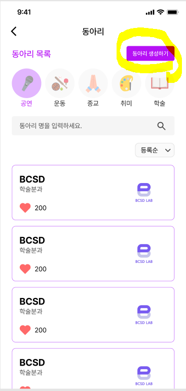
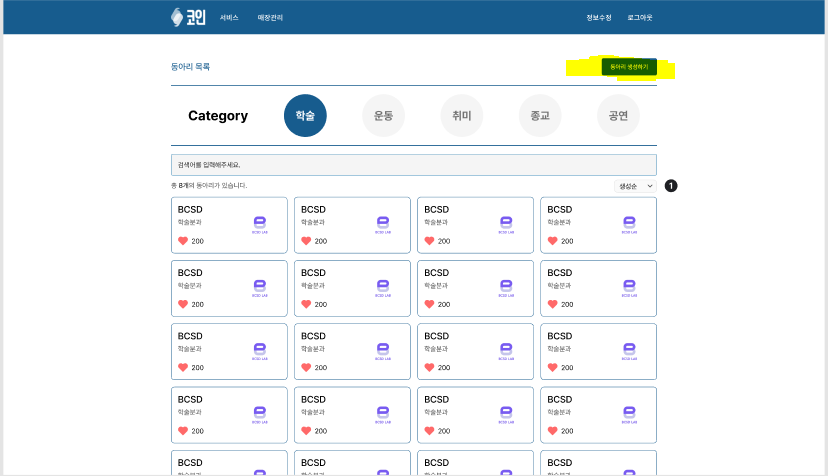

# 2-2.동아리_동아리 생성하기 클릭

[← 콜밴팟 목록](README.md)

플랫폼: WEB, ANDROID, IOS  
원문 상태: 완료  
[Notion 기준 명세](https://app.notion.com/p/79b0221954bc831292bf81ee7a39c7b2)  
원본 ID: `79b0221954bc831292bf81ee7a39c7b2`

<!-- notion-body:start -->
- 설명: 동아리 메인화면에서 동아리 생성하기 클릭 (로그인 유저만 로깅 적용)
- event\_name : “CAMPUS”
- event\_label : “club\_main\_create”
- value : “생성하기”
- event\_category : “click”
- 참고사진



- 웹 참고사진


<!-- notion-body:end -->

<details>
<summary>Notion 원문 속성 전체</summary>

```json
{
  "platform": [
    "WEB",
    "ANDROID",
    "IOS"
  ],
  "url": "https://app.notion.com/p/79b0221954bc831292bf81ee7a39c7b2",
  "상태": "완료",
  "이름": "2-2.동아리\\_동아리 생성하기 클릭"
}
```

</details>
