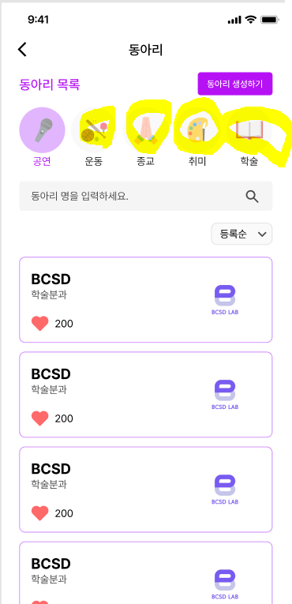
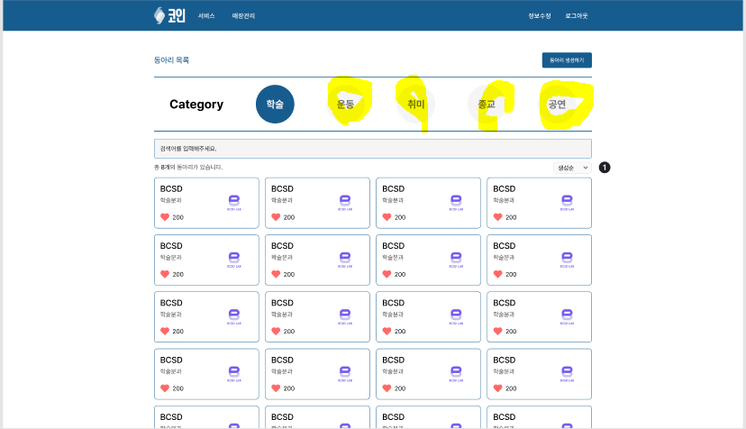

# 2-3.동아리_동아리 카테고리 클릭

[← 콜밴팟 목록](README.md)

플랫폼: WEB, ANDROID, IOS  
원문 상태: 완료  
[Notion 기준 명세](https://app.notion.com/p/39f0221954bc8379bb518116cec36fb5)  
원본 ID: `39f0221954bc8379bb518116cec36fb5`

<!-- notion-body:start -->
- 설명: 동아리 메인화면에서 동아리 카테고리 클릭
- event\_name : “CAMPUS”
- event\_label : “club\_main\_category”
- value : \{”공연”,”운동”,”종교”,”취미”,”학술”\}
- event\_category : “click”
- 참고사진



- 웹 참고사진


<!-- notion-body:end -->

<details>
<summary>Notion 원문 속성 전체</summary>

```json
{
  "platform": [
    "WEB",
    "ANDROID",
    "IOS"
  ],
  "url": "https://app.notion.com/p/39f0221954bc8379bb518116cec36fb5",
  "상태": "완료",
  "이름": "2-3.동아리\\_동아리 카테고리 클릭"
}
```

</details>
