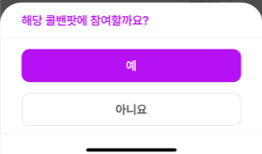
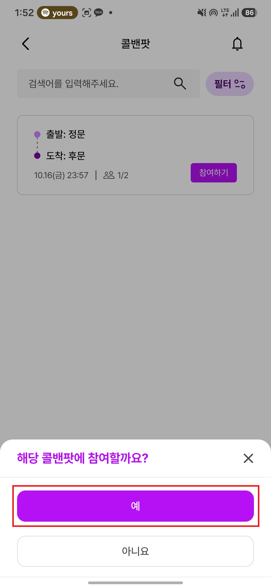

# 2-4 콜밴팟 참여하기

[← 콜밴팟 로깅 목록](README.md)

플랫폼: ANDROID · IOS  
원문 상태: 로깅 필요

과거 로깅·새 로깅과 각 참고사진은 원문의 구간별 연결을 유지합니다.

<!-- logging-section:past:start -->
## 과거 로깅

- event\_name : CAMPUS
- event\_category : click
- event\_label : callvan\_join
- value : 예, 아니요

<!-- logging-section:past:end -->

<!-- logging-section:new:start -->
## 새 로깅

- 설명: 목록에서 참여하기로 연 확인 모달의 예 또는 아니요를 클릭한다.
- screen\_view: <code>callvan_list</code>
- event\_label: <code>callvan__callvan_list__callvan_participation__join_response__click</code>
- event\_name: <code>DA2</code>
- value: 예, 아니요
- event\_category: <code>click</code>
- 발생 시점 확정: 참여 확인 모달의 ‘예’ 또는 ‘아니오’ 확인 응답 버튼을 클릭하는 순간 전송한다. 모달을 여는 참여하기 클릭이나 서버의 참여 성공 응답에서는 이 이벤트를 추가 전송하지 않는다. 기존 응답 value는 유지한다.

### 참고사진 (기능 표시)

#### 모바일

사용자가 실제 화면으로 교체 완료한 사진(2026-10-16). 현재 첨부 이미지를 유지한다.

<!-- logging-section:new:end -->

---

원문 정보

원본 ID: `c300221954bc8344ba00817a5d0e70b8`  
[보존 원문](../../_archive/original/notion/pages/c300221954bc8344ba00817a5d0e70b8.md)

