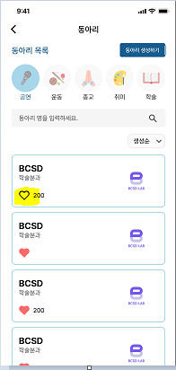
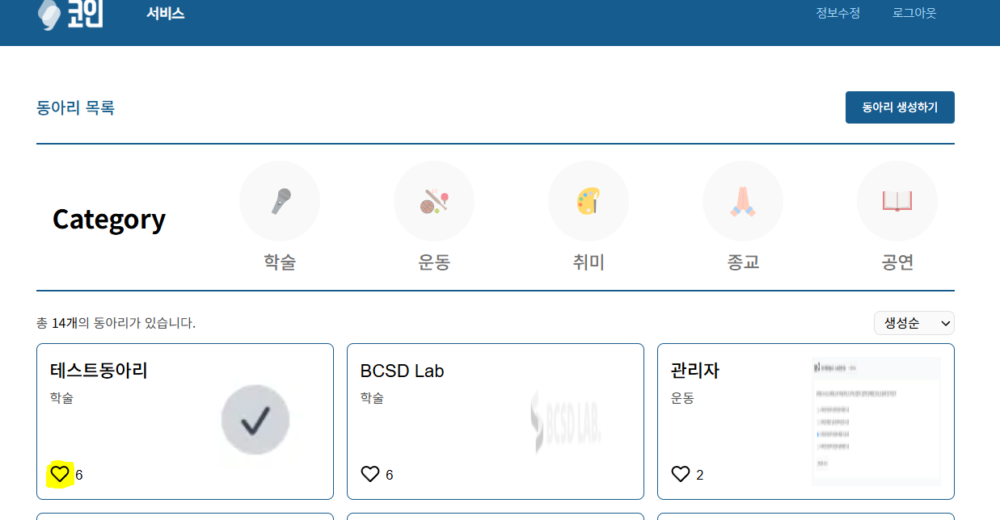

# 2-4.동아리_동아리 메인화면 좋아요 클릭

[← 콜밴팟 목록](README.md)

플랫폼: WEB, ANDROID, IOS  
원문 상태: 완료  
[Notion 기준 명세](https://app.notion.com/p/6930221954bc82f588ed015453c82e40)  
원본 ID: `6930221954bc82f588ed015453c82e40`

<!-- notion-body:start -->
- 설명: 동아리 메인화면에서 특정 동아리의  흰 하트모양 좋아요 버튼 클릭(로그인 유저만 로깅 적용)
- event\_name : “CAMPUS”
- event\_label : “club\_main\_like”
- value : “동아리명”
- event\_category : “click”
- 참고사진



- 웹 참고사진


<!-- notion-body:end -->

<details>
<summary>Notion 원문 속성 전체</summary>

```json
{
  "platform": [
    "WEB",
    "ANDROID",
    "IOS"
  ],
  "url": "https://app.notion.com/p/6930221954bc82f588ed015453c82e40",
  "상태": "완료",
  "이름": "2-4.동아리\\_동아리 메인화면 좋아요 클릭"
}
```

</details>
