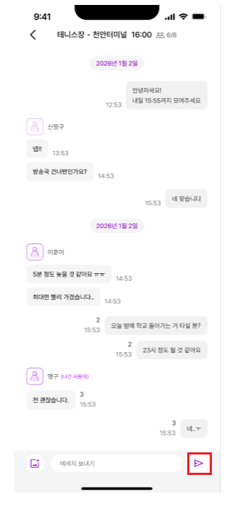
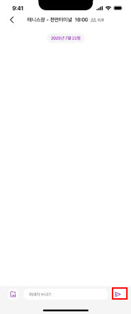

# 2-7  콜밴팟 채팅 전송

[← 콜밴팟 목록](README.md)

플랫폼: ANDROID, IOS  
원문 상태: 로깅 필요  
[Notion 기준 명세](https://app.notion.com/p/d1b0221954bc83559f3f0181593cc36b)  
원본 ID: `d1b0221954bc83559f3f0181593cc36b`

<!-- notion-body:start -->
## 과거 로깅

개인정보정책상? 이건 될지 안 될지 모르겠네여

- event\_name : CAMPUS
- event\_category : click
- event\_label : callvan\_chat\_send
- value :



## 새 로깅

- 설명: 콜밴팟 단체채팅 화면에서 메시지 전송 버튼을 클릭한다.
- screen\_view: <code>callvan_chat</code>
- event\_label: <code>callvan__callvan_chat__callvan_chat__message_send__click</code>
- event\_name: <code>DA2</code>
- value: 메시지 전송
- event\_category: <code>click</code>

### 참고사진 (기능 표시)

<b>모바일 (ANDROID, IOS) / 캡처 출처는 아래 참조</b>

<b>참고사진 · 모바일</b>

Figma 참고 / 실제 화면 미확인. 사용자 확정에 따라 기존 사진을 유지하며 실제 캡처 교체를 대기 조건으로 두지 않는다. 앱 프레임 48921-195643.


<!-- notion-body:end -->

<details>
<summary>Notion 원문 속성 전체</summary>

```json
{
  "platform": [
    "ANDROID",
    "IOS"
  ],
  "url": "https://app.notion.com/p/d1b0221954bc83559f3f0181593cc36b",
  "상태": "로깅 필요",
  "이름": "2-7  콜밴팟 채팅 전송",
  "태그": [
    "2. 콜밴팟 찾기"
  ]
}
```

</details>
