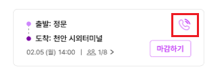
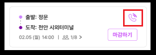

# 2-8  콜밴팟 전화 클릭

[← 콜밴팟 목록](README.md)

플랫폼: ANDROID, IOS  
원문 상태: 로깅 필요  
[Notion 기준 명세](https://app.notion.com/p/0610221954bc8359a9c4013f54bf8a3e)  
원본 ID: `0610221954bc8359a9c4013f54bf8a3e`

<!-- notion-body:start -->
## 과거 로깅

콜밴 모집자 화면 기준 로깅입니다.

- event\_name : CAMPUS
- event\_category : click
- event\_label : callvan\_call
- value :



## 새 로깅

- 설명: 콜밴 모집자 기준으로 목록의 팟 카드 전화 아이콘을 클릭한다.
- screen\_view: <code>callvan_list</code>
- event\_label: <code>callvan__callvan_list__contact__phone__click</code>
- event\_name: <code>DA2</code>
- value: 기존 미기재 유지
- event\_category: <code>click</code>

### 참고사진 (기능 표시)

<b>모바일 (ANDROID, IOS) / 캡처 출처는 아래 참조</b>

<b>참고사진 · 모바일</b>

최근 모바일 캡처 사본. 사용자 재확인 (2026-10-16): 현재 앱과 동일한 모집자 팟 카드. 에이전트의 추가 실기기·수집 검수는 별도.


<!-- notion-body:end -->

<details>
<summary>Notion 원문 속성 전체</summary>

```json
{
  "platform": [
    "ANDROID",
    "IOS"
  ],
  "url": "https://app.notion.com/p/0610221954bc8359a9c4013f54bf8a3e",
  "상태": "로깅 필요",
  "이름": "2-8  콜밴팟 전화 클릭",
  "태그": [
    "2. 콜밴팟 찾기"
  ]
}
```

</details>
