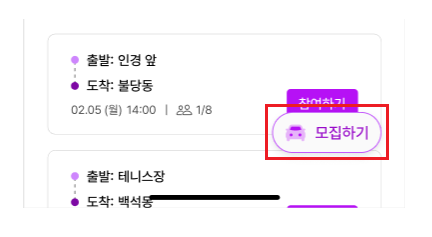
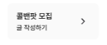
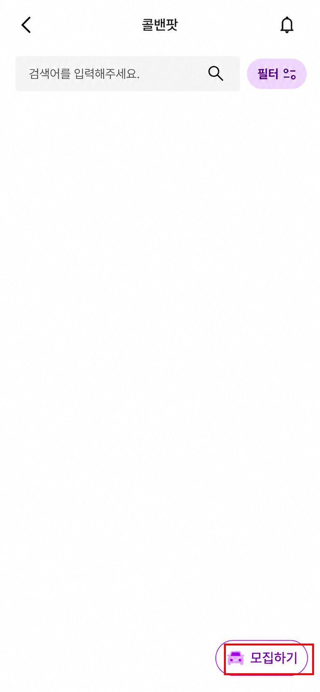

# 2-9·3-6 콜밴팟 목록 → 모집하기

[← 콜밴팟 목록](README.md)

플랫폼: ANDROID, IOS  
원문 상태: 로깅 필요  
[Notion 기준 명세](https://app.notion.com/p/aaf0221954bc838392610164dea9dfac)  
원본 ID: `aaf0221954bc838392610164dea9dfac`

<!-- notion-body:start -->
## 과거 로깅

- event\_name : CAMPUS
- event\_category : click
- event\_label : callvan\_create
- value :



- event\_name : CAMPUS
- event\_category : click
- event\_label : main\_callvan\_write
- value :



## 새 로깅

- 설명: 콜밴팟 목록의 ‘모집하기’ 버튼을 클릭한다. (2-9: 목록에서 모집하기 클릭 / 3-6: 리디자인 메인의 ‘모집 보기’로 목록에 진입한 뒤 목록의 ‘모집하기’ 클릭. 이벤트는 두 번째 클릭에서 발생하며 두 진입 경로는 같은 클릭이므로 중복 전송하지 않는다.)
- screen\_view: <code>callvan_list</code> (2-9·3-6 동일)
- event\_label: <code>callvan__callvan_list__callvan_write__entry__click</code>
- event\_name: <code>DA2</code>
- value: 기존 미기재 유지
- event\_category: <code>click</code>

### 참고사진 (기능 표시)

<b>모바일 (ANDROID, IOS) / 캡처 출처는 아래 참조</b>

<b>참고사진 · 모바일</b>

\[2-9 원본\] 화면 정의의 Android 실제 캡처(2026-10-13), 선명도 개선본. 이번 작업은 기존 캡처를 사용.



\[3-6 원본\] Android 실제 목록 캡처(2026-10-13)의 선명도 개선본. 목록 오른쪽 아래 ‘모집하기’를 표시.


<!-- notion-body:end -->

<details>
<summary>Notion 원문 속성 전체</summary>

```json
{
  "platform": [
    "ANDROID",
    "IOS"
  ],
  "url": "https://app.notion.com/p/aaf0221954bc838392610164dea9dfac",
  "상태": "로깅 필요",
  "이름": "2-9·3-6 콜밴팟 목록 → 모집하기",
  "태그": [
    "2. 콜밴팟 찾기",
    "3. 콜밴팟 모집"
  ]
}
```

</details>
