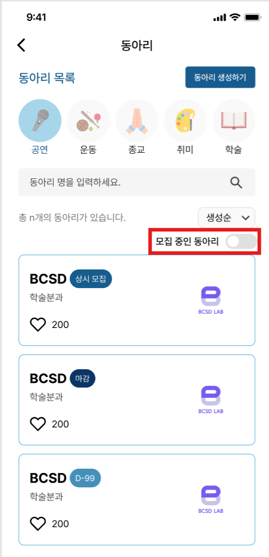

# 2.6 동아리_모집 중인 동아리 토글 클릭

[← 콜밴팟 목록](README.md)

플랫폼: ANDROID, IOS, WEB  
원문 상태: 로깅 필요  
[Notion 기준 명세](https://app.notion.com/p/2e50221954bc8311942a010a84a9948a)  
원본 ID: `2e50221954bc8311942a010a84a9948a`

<!-- notion-body:start -->
- 설명: 동아리 메인화면에서 모집 중인 동아리 토글 ON/OFF
- event\_name : “CAMPUS”
- event\_label : “club\_main\_recruiting\_toggle”
- value : \{on / off\} // ‘on’ 또는 ‘off’ 값을 가지는 형태
- event\_category : “click”
- 참고사진



- 웹 참고사진


<!-- notion-body:end -->

<details>
<summary>Notion 원문 속성 전체</summary>

```json
{
  "platform": [
    "ANDROID",
    "IOS",
    "WEB"
  ],
  "url": "https://app.notion.com/p/2e50221954bc8311942a010a84a9948a",
  "상태": "로깅 필요",
  "이름": "2.6 동아리\\_모집 중인 동아리 토글 클릭"
}
```

</details>
