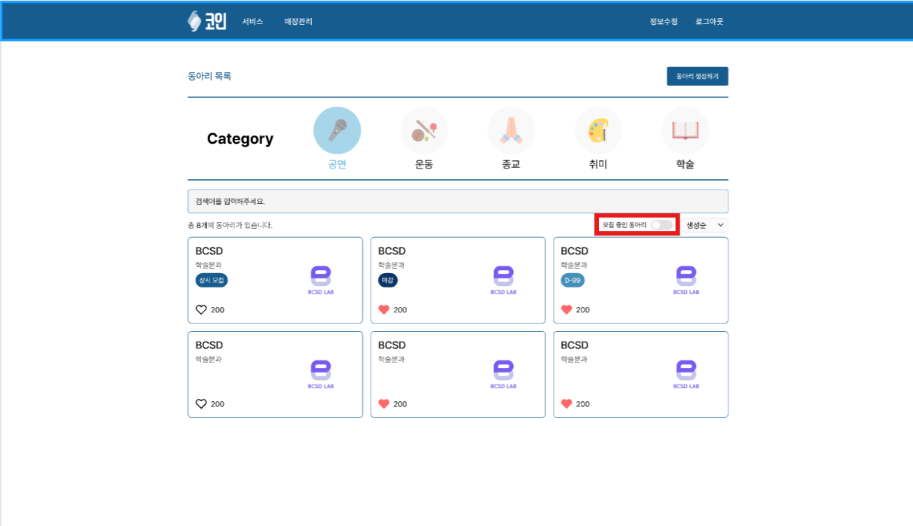

# 2.6 동아리_모집 중인 동아리 토글 클릭

[← 콜밴팟 로깅 목록](README.md)

플랫폼: ANDROID · IOS · WEB  
원문 상태: 로깅 필요

원문에 과거·새 로깅 구분이 없어 아래 정의와 참고사진을 원문 순서로 표시합니다.

원문 미기재 항목: `screen_view`. 값을 추정하지 않았습니다.

- 설명: 동아리 메인화면에서 모집 중인 동아리 토글 ON/OFF

- event\_name : “CAMPUS”

- event\_label : “club\_main\_recruiting\_toggle”

- value : \{on / off\} // ‘on’ 또는 ‘off’ 값을 가지는 형태

- event\_category : “click” 

- 웹 참고사진

---

원문 정보

원본 ID: `6780221954bc82c6a79f0110b9709435`  
[보존 원문](../../_archive/original/notion/pages/6780221954bc82c6a79f0110b9709435.md)

