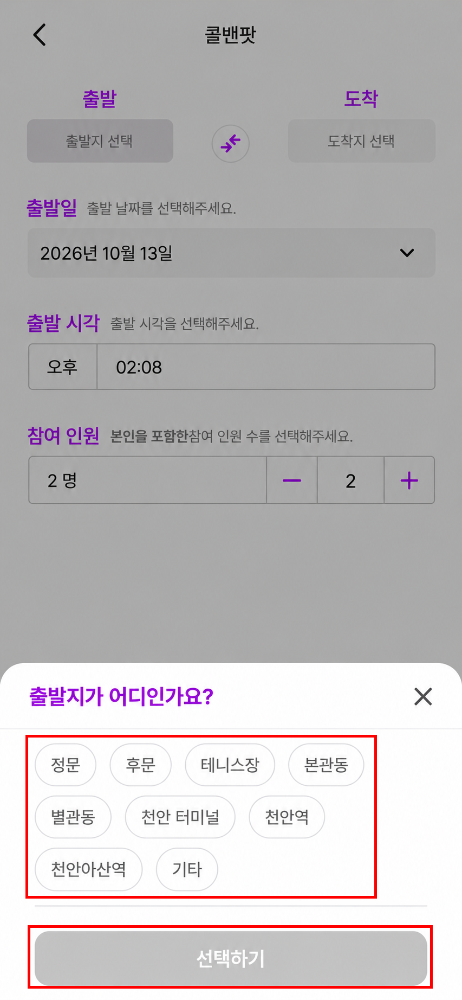

# 3-1 콜밴팟 출발지 선택

[← 콜밴팟 로깅 목록](README.md)

플랫폼: ANDROID · IOS  
원문 상태: 로깅 필요

과거 로깅·새 로깅과 각 참고사진은 원문의 구간별 연결을 유지합니다.

태그: 3. 콜밴팟 모집
platform: ANDROID, IOS
상태: 로깅 필요

<!-- logging-section:past:start -->
## 과거 로깅

- event\_name : CAMPUS
- event\_category : click
- event\_label : callvan\_write\_departure
- value
  - 예시 : 교내, 정문
  - 예시 : 교외, 천안 터미널
  - 예시 : 교내, 기타, 인문경영관

<!-- logging-section:past:end -->

<!-- logging-section:new:start -->
## 새 로깅

- 설명: 모집글 작성 화면 위 출발지 선택 바텀시트에서 장소를 선택하고 선택하기를 클릭한다.
- screen\_view: `callvan_write`
- event\_label: `callvan__callvan_write__callvan_write__departure_confirm__click`
- event\_name: `DA2`
- value: - 예시 : 교내, 정문 - 예시 : 교외, 천안 터미널 - 예시 : 교내, 기타, 인문경영관
- event\_category: `click`
- 발생 시점 확정: 출발지 선택 바텀시트의 ‘선택하기’ 버튼을 누르는 순간, 최종 선택한 출발지를 기존 value 형식으로 전송한다. 장소 항목을 고르는 중에는 이 이벤트를 전송하지 않는다. 2026-10-15 Android에서 출발지 선택 바텀시트와 하단 ‘선택하기’ 버튼을 실제 확인했다.

### 참고사진 (기능 표시)

#### 모바일

화면 정의의 Android 실제 캡처(2026-10-13), 선명도 개선본. 이번 작업은 기존 캡처를 사용. 추가 출발지 바텀시트 이미지.

<!-- logging-section:new:end -->

---

원문 정보

원본 ID: `e640221954bc82429edd8117e763ab61`  
[보존 원문](../../_archive/original/notion/pages/e640221954bc82429edd8117e763ab61.md)

