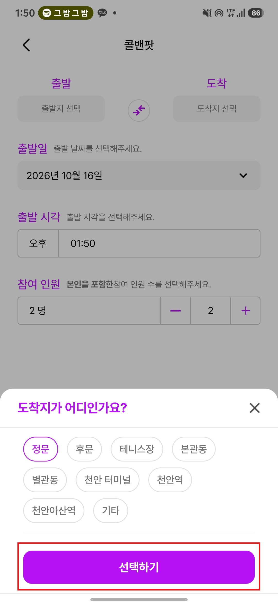

# 3-2 콜밴팟 도착지 선택

[← 콜밴팟 로깅 목록](README.md)

플랫폼: ANDROID · IOS  
원문 상태: 로깅 필요

과거 로깅·새 로깅과 각 참고사진은 원문의 구간별 연결을 유지합니다.

태그: 3. 콜밴팟 모집
platform: ANDROID, IOS
상태: 로깅 필요

<!-- logging-section:past:start -->
## 과거 로깅

- event\_name : CAMPUS
- event\_category : click
- event\_label : callvan\_write\_arrival
- value :
  - 예시 : 교내, 정문
  - 예시 : 교외, 천안 터미널
  - 예시 : 교내, 기타, 인문경영관

<!-- logging-section:past:end -->

<!-- logging-section:new:start -->
## 새 로깅

- 설명: 모집글 작성 화면 위 도착지 선택 바텀시트에서 장소를 선택하고 선택하기를 클릭한다.
- screen\_view: `callvan_write`
- event\_label: `callvan__callvan_write__callvan_write__arrival_confirm__click`
- event\_name: `DA2`
- value: - 예시 : 교내, 정문 - 예시 : 교외, 천안 터미널 - 예시 : 교내, 기타, 인문경영관
- event\_category: `click`

### 참고사진 (기능 표시)

<b>모바일 (ANDROID, IOS) / 캡처 출처는 아래 참조</b>

<b>참고사진 · 모바일</b>

<!-- logging-section:new:end -->

---

원문 정보

원본 ID: `b790221954bc8365a0d3811f1c79910b`  
[보존 원문](../../_archive/original/notion/pages/b790221954bc8365a0d3811f1c79910b.md)

