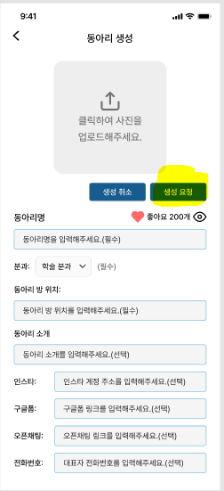

# 3-2. 동아리_동아리 생성요청

[← 콜밴팟 로깅 목록](README.md)

플랫폼: ANDROID · IOS · WEB  
원문 상태: 완료

원문에 과거·새 로깅 구분이 없어 아래 정의와 참고사진을 원문 순서로 표시합니다.

원문 미기재 항목: `screen_view`. 값을 추정하지 않았습니다.

- 설명: 동아리 생성 화면 에서 생성 요청 클릭

- event\_name : “CAMPUS”

- event\_label : “club\_create\_request”

- value : “생성요청”

- event\_category : “click” 

- 참고사진

- 웹 참고사진

---

원문 정보

원본 ID: `c510221954bc83219e86812231e78af3`  
[보존 원문](../../_archive/original/notion/pages/c510221954bc83219e86812231e78af3.md)

