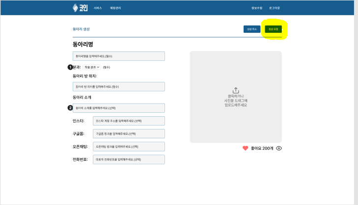

# 3-2. 동아리_동아리 생성요청

[← 콜밴팟 목록](README.md)

플랫폼: ANDROID, IOS, WEB  
원문 상태: 완료  
[Notion 기준 명세](https://app.notion.com/p/eaa0221954bc826c821581567b5c1063)  
원본 ID: `eaa0221954bc826c821581567b5c1063`

<!-- notion-body:start -->
- 설명: 동아리 생성 화면 에서 생성 요청 클릭
- event\_name : “CAMPUS”
- event\_label : “club\_create\_request”
- value : “생성요청”
- event\_category : “click”
- 참고사진


- 웹 참고사진


<!-- notion-body:end -->

<details>
<summary>Notion 원문 속성 전체</summary>

```json
{
  "platform": [
    "ANDROID",
    "IOS",
    "WEB"
  ],
  "url": "https://app.notion.com/p/eaa0221954bc826c821581567b5c1063",
  "상태": "완료",
  "이름": "3-2. 동아리\\_동아리 생성요청"
}
```

</details>
