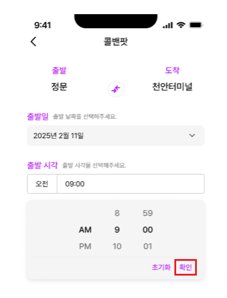
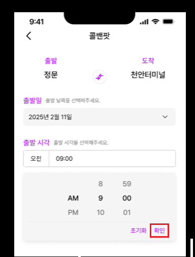

# 3-3 콜밴팟 출발 시각 선택

[← 콜밴팟 로깅 목록](README.md)

플랫폼: ANDROID · IOS  
원문 상태: 로깅 필요

과거 로깅·새 로깅과 각 참고사진은 원문의 구간별 연결을 유지합니다.

<!-- logging-section:past:start -->
## 과거 로깅

- event\_name : CAMPUS
- event\_category : click
- event\_label : callvan\_write\_time
- value :
  - 해당하는 시각

<!-- logging-section:past:end -->

<!-- logging-section:new:start -->
## 새 로깅

- 설명: 모집글 작성 화면의 출발 시각 선택 UI에서 시각을 확정한다.
- screen\_view: <code>callvan_write</code>
- event\_label: <code>callvan__callvan_write__callvan_write__departure_time_confirm__click</code>
- event\_name: <code>DA2</code>
- value: - 해당하는 시각
- event\_category: <code>click</code>
- 발생 시점 확정: 출발 시각 선택 UI의 ‘확인’ 버튼을 누르는 순간 최종 시각을 전송한다. picker 값을 변경하는 중에는 이 이벤트를 전송하지 않는다. 기존 category click과 시각 value 형식은 유지한다. 2026-10-15 Android에서 출발 시각 picker와 ‘확인’ 버튼을 실제 확인했다.

### 참고사진 (기능 표시)

#### 모바일

기존 모바일 캡처 사본. 현재 Android 화면·지원 여부 미확인. 시간 선택 UI와 확인 버튼.

<!-- logging-section:new:end -->

---

원문 정보

원본 ID: `8d80221954bc83cd943b814a44fee4bb`  
[보존 원문](../../_archive/original/notion/pages/8d80221954bc83cd943b814a44fee4bb.md)

