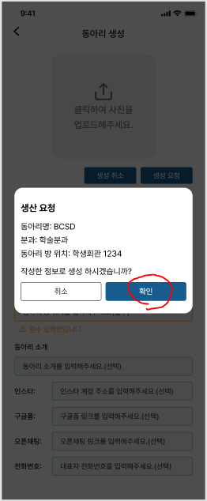

# 3-3. 동아리_동아리 생성요청_확인

[← 콜밴팟 로깅 목록](README.md)

플랫폼: ANDROID · IOS · WEB  
원문 상태: 완료

원문에 과거·새 로깅 구분이 없어 아래 정의와 참고사진을 원문 순서로 표시합니다.

원문 미기재 항목: `screen_view`. 값을 추정하지 않았습니다.

- 설명: 동아리 생성 화면 의 생성요청 팝업에서 확인 클릭

- event\_name : “CAMPUS”

- event\_label : “club\_create\_request\_check”

- value : “확인”

- event\_category : “click” 

- 참고사진

- 웹 참고사진

---

원문 정보

원본 ID: `8420221954bc83dab20481011b2cd2a8`  
[보존 원문](../../_archive/original/notion/pages/8420221954bc83dab20481011b2cd2a8.md)

