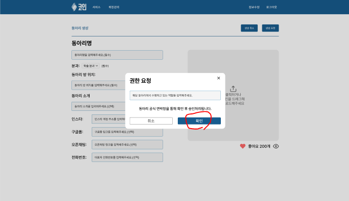

# 3-4. 동아리_동아리 권한요청

[← 콜밴팟 목록](README.md)

플랫폼: ANDROID, IOS, WEB  
원문 상태: 완료  
[Notion 기준 명세](https://app.notion.com/p/9cb0221954bc83d88fa7014e63259e2b)  
원본 ID: `9cb0221954bc83d88fa7014e63259e2b`

<!-- notion-body:start -->
- 설명: 동아리 생성 화면의 권한요청 팝업에서 확인 클릭
- event\_name : “CAMPUS”
- event\_label : “club\_create\_request\_authority”
- value : 텍스트 박스 내의 값
- event\_category : “click”
- 참고사진


- 웹 참고사진


<!-- notion-body:end -->

<details>
<summary>Notion 원문 속성 전체</summary>

```json
{
  "platform": [
    "ANDROID",
    "IOS",
    "WEB"
  ],
  "url": "https://app.notion.com/p/9cb0221954bc83d88fa7014e63259e2b",
  "상태": "완료",
  "이름": "3-4. 동아리\\_동아리 권한요청"
}
```

</details>
