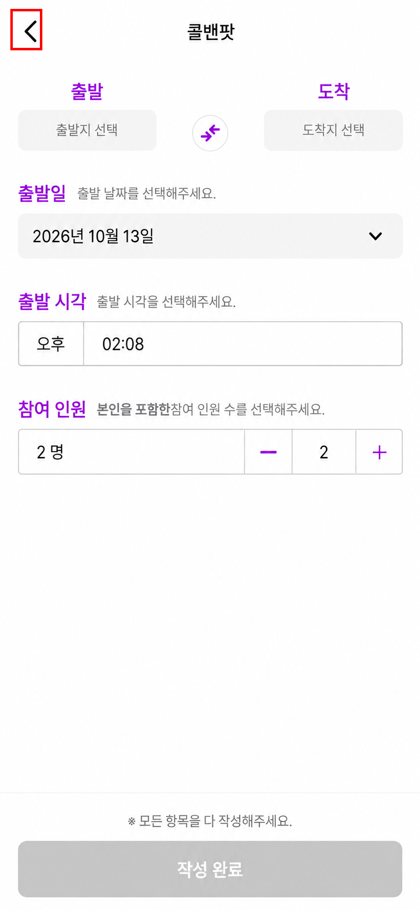

# 3-5 콜밴팟 모집 이탈

[← 콜밴팟 목록](README.md)

플랫폼: ANDROID, IOS  
원문 상태: 로깅 필요  
[Notion 기준 명세](https://app.notion.com/p/be30221954bc83f1b8a5019f78b03299)  
원본 ID: `be30221954bc83f1b8a5019f78b03299`

<!-- notion-body:start -->
## 과거 로깅

- event\_name : CAMPUS
- event\_category
  - click
  - swipe
- event\_label : callvan\_write\_back
- value :


## 새 로깅

- 설명: 모집글 작성 화면에서 뒤로가기 클릭 또는 OS 스와이프로 이탈한다.
- screen\_view: <code>callvan_write</code>
- event\_label: <code>callvan__callvan_write__navigation__back__click / callvan__callvan_write__navigation__back__swipe (iOS만 해당)</code>
- event\_name: <code>DA2</code>
- value: 뒤로가기
- event\_category: <code>click / swipe (iOS만 해당)</code>

### 참고사진 (기능 표시)

<b>모바일 (ANDROID, IOS) / 캡처 출처는 아래 참조</b>

<b>참고사진 · 모바일</b>

화면 정의의 Android 실제 캡처(2026-10-13), 선명도 개선본. 이번 작업은 기존 캡처를 사용. 박스는 뒤로가기 클릭 대상.


<!-- notion-body:end -->

<details>
<summary>Notion 원문 속성 전체</summary>

```json
{
  "platform": [
    "ANDROID",
    "IOS"
  ],
  "url": "https://app.notion.com/p/be30221954bc83f1b8a5019f78b03299",
  "상태": "로깅 필요",
  "이름": "3-5 콜밴팟 모집 이탈",
  "태그": [
    "3. 콜밴팟 모집"
  ]
}
```

</details>
