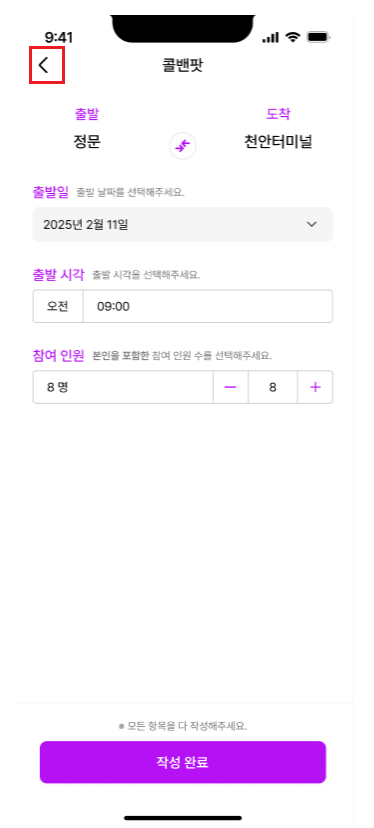

# 3-5 콜밴팟 모집 이탈

[← 콜밴팟 로깅 목록](README.md)

플랫폼: ANDROID · IOS  
원문 상태: 로깅 필요

과거 로깅·새 로깅과 각 참고사진은 원문의 구간별 연결을 유지합니다.

<!-- logging-section:past:start -->
## 과거 로깅

- event\_name : CAMPUS
- event\_category
  - click
  - swipe
- event\_label : callvan\_write\_back
- value :

<!-- logging-section:past:end -->

<!-- logging-section:new:start -->
## 새 로깅

- 설명: 모집글 작성 화면에서 뒤로가기 클릭 또는 OS 스와이프로 이탈한다.
- screen\_view: <code>callvan_write</code>
- event\_label: <code>callvan__callvan_write__navigation__back__click / callvan__callvan_write__navigation__back__swipe (iOS만 해당)</code>
- event\_name: <code>DA2</code>
- value: 기존 미기재 유지
- event\_category: <code>click / swipe (iOS만 해당)</code>

### 참고사진 (기능 표시)

#### 모바일

화면 정의의 Android 실제 캡처(2026-10-13), 선명도 개선본. 이번 작업은 기존 캡처를 사용. 박스는 뒤로가기 클릭 대상.

<!-- logging-section:new:end -->

---

원문 정보

원본 ID: `c700221954bc83e2938701df1990f7d9`  
[보존 원문](../../_archive/original/notion/pages/c700221954bc83e2938701df1990f7d9.md)

