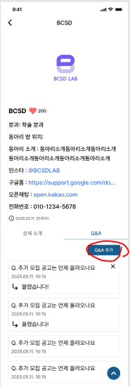

# 4-1. 동아리_Q&A추가

[← 콜밴팟 로깅 목록](README.md)

플랫폼: ANDROID · IOS  
원문 상태: 완료

원문에 과거·새 로깅 구분이 없어 아래 정의와 참고사진을 원문 순서로 표시합니다.

원문 미기재 항목: `screen_view`. 값을 추정하지 않았습니다.

- 설명: 동아리 상세 화면 에서 Q&A 추가 클릭

- event\_name : “CAMPUS”

- event\_label : “club\_Q&A\_add”

- value : “Q&A”

- event\_category : “click” 

- 참고사진

---

원문 정보

원본 ID: `a260221954bc8353b7b38155f131c036`  
[보존 원문](../../_archive/original/notion/pages/a260221954bc8353b7b38155f131c036.md)

