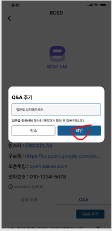
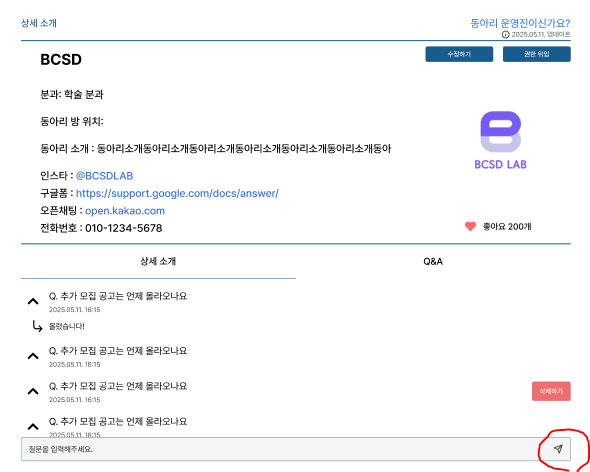

# 4-2. 동아리_Q&A추가_확인

[← 콜밴팟 목록](README.md)

플랫폼: ANDROID, IOS, WEB  
원문 상태: 완료  
[Notion 기준 명세](https://app.notion.com/p/7bc0221954bc83df82fa817ac8b3f63c)  
원본 ID: `7bc0221954bc83df82fa817ac8b3f63c`

<!-- notion-body:start -->
- 설명:

모바일 :Q&A 추가 팝업 에서 확인 클릭

웹 : 질문 입력창의 우측에 있는 버튼 클릭

- event\_name : “CAMPUS”
- event\_label : “club\_Q&A\_add\_confirm”
- value : “Q&A”
- event\_category : “click”
- 참고사진



- 웹 참고사진


<!-- notion-body:end -->

<details>
<summary>Notion 원문 속성 전체</summary>

```json
{
  "platform": [
    "ANDROID",
    "IOS",
    "WEB"
  ],
  "url": "https://app.notion.com/p/7bc0221954bc83df82fa817ac8b3f63c",
  "상태": "완료",
  "이름": "4-2. 동아리\\_Q&A추가\\_확인"
}
```

</details>
