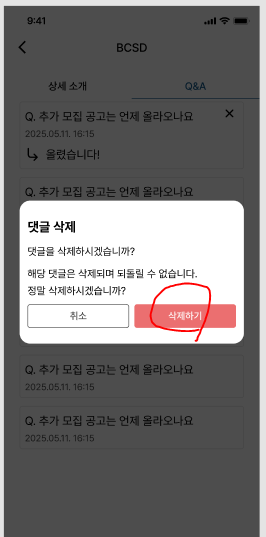
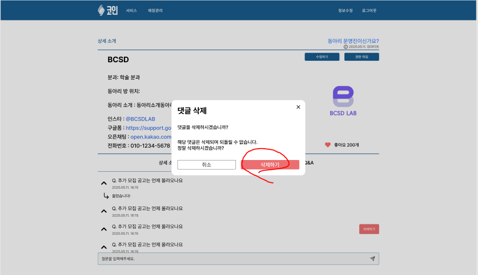
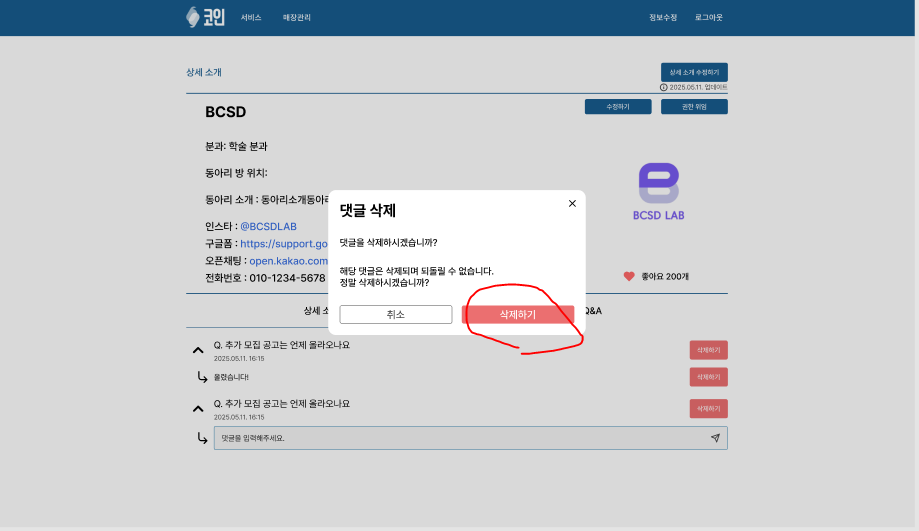

# 4-3. 동아리_댓글 삭제

[← 콜밴팟 로깅 목록](README.md)

플랫폼: ANDROID · IOS · WEB  
원문 상태: 완료

원문에 과거·새 로깅 구분이 없어 아래 정의와 참고사진을 원문 순서로 표시합니다.

원문 미기재 항목: `screen_view`. 값을 추정하지 않았습니다.

- 설명: 댓글 삭제 팝업에서 삭제하기 클릭

- event\_name : “CAMPUS”

- event\_label : “club\_Q&A\_delete\_confirm”

- value : “삭제하기”

- event\_category : “click” 

- 참고사진

- 웹 참고사진

- 웹 참고사진2(관리자 버전)

---

원문 정보

원본 ID: `dcc0221954bc828b8856013ad4c40742`  
[보존 원문](../../_archive/original/notion/pages/dcc0221954bc828b8856013ad4c40742.md)

