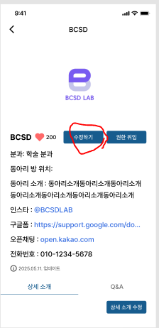

# 5-1.동아리_수정하기 클릭

[← 콜밴팟 로깅 목록](README.md)

플랫폼: ANDROID · IOS · WEB  
원문 상태: 완료

원문에 과거·새 로깅 구분이 없어 아래 정의와 참고사진을 원문 순서로 표시합니다.

원문 미기재 항목: `screen_view`. 값을 추정하지 않았습니다.

- 설명: 동아리 소개 화면에서 수정하기 버튼 클릭

- event\_name : “CAMPUS”

- event\_label : “club\_correction”

- value : “수정하기”

- event\_category : “click” 

- 웹 참고사진

---

원문 정보

원본 ID: `9d20221954bc82788c8f01374d2d0e97`  
[보존 원문](../../_archive/original/notion/pages/9d20221954bc82788c8f01374d2d0e97.md)

