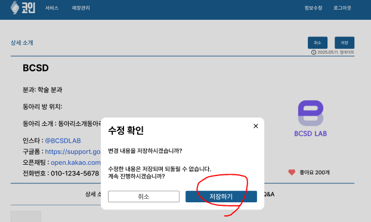

# 5-10.동아리_상세소개 수정하기_저장하기 클릭

[← 콜밴팟 목록](README.md)

플랫폼: WEB  
원문 상태: 완료  
[Notion 기준 명세](https://app.notion.com/p/86c0221954bc827487be8160a1020457)  
원본 ID: `86c0221954bc827487be8160a1020457`

<!-- notion-body:start -->
- 설명: 동아리 소개 화면 → 상세소개의 수정확인 모달에서 저장하기 클릭
- event\_name : “CAMPUS”
- event\_label : “club\_introduction\_correction\_save\_confirm”
- value : “저장하기”
- event\_category : “click”

- 웹 참고사진


<!-- notion-body:end -->

<details>
<summary>Notion 원문 속성 전체</summary>

```json
{
  "platform": [
    "WEB"
  ],
  "url": "https://app.notion.com/p/86c0221954bc827487be8160a1020457",
  "상태": "완료",
  "이름": "5-10.동아리\\_상세소개 수정하기\\_저장하기 클릭"
}
```

</details>
