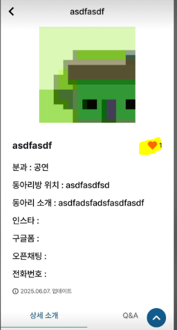
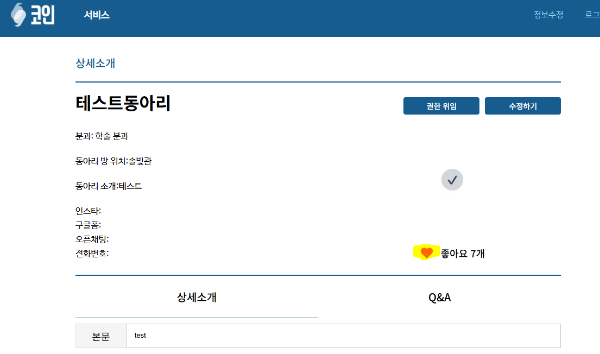

# 5-13.동아리_상세소개 좋아요 해제

[← 콜밴팟 로깅 목록](README.md)

플랫폼: ANDROID · IOS · WEB  
원문 상태: 완료

원문에 과거·새 로깅 구분이 없어 아래 정의와 참고사진을 원문 순서로 표시합니다.

원문 미기재 항목: `screen_view`. 값을 추정하지 않았습니다.

- 설명: 동아리 상세소개 화면에서  이미 클릭한 빨간 하트모양 좋아요 버튼 클릭해서 해제 (로그인 유저만 로깅 적용)

- event\_name : “CAMPUS”

- event\_label : “club\_introduction\_like\_cancel”

- value : “동아리명”

- event\_category : “click” 

- 웹 참고사진

---

원문 정보

원본 ID: `9c70221954bc83449b2a01df96f54439`  
[보존 원문](../../_archive/original/notion/pages/9c70221954bc83449b2a01df96f54439.md)

