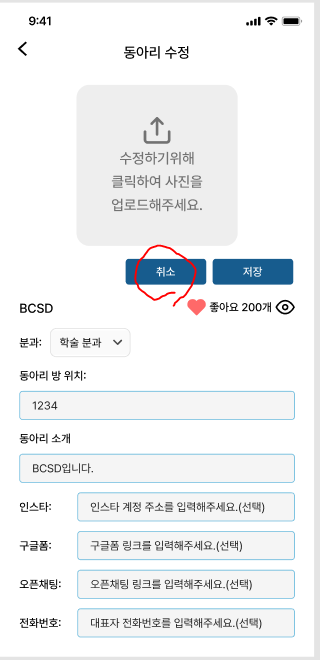
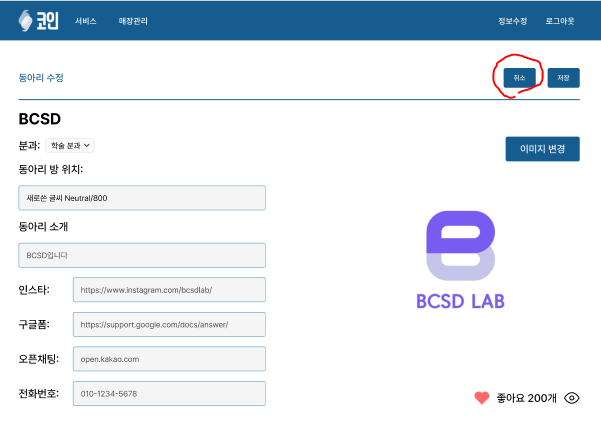

# 5-3.동아리_정보수정 취소

[← 콜밴팟 목록](README.md)

플랫폼: ANDROID, IOS, WEB  
원문 상태: 완료  
[Notion 기준 명세](https://app.notion.com/p/38e0221954bc827083078171a7f29f98)  
원본 ID: `38e0221954bc827083078171a7f29f98`

<!-- notion-body:start -->
- 설명: 동아리 수정 화면에서 취소 버튼 클릭
- event\_name : “CAMPUS”
- event\_label : “club\_correction\_cancel”
- value : “취소”
- event\_category : “click”
- 참고사진



- 웹 참고사진


<!-- notion-body:end -->

<details>
<summary>Notion 원문 속성 전체</summary>

```json
{
  "platform": [
    "ANDROID",
    "IOS",
    "WEB"
  ],
  "url": "https://app.notion.com/p/38e0221954bc827083078171a7f29f98",
  "상태": "완료",
  "이름": "5-3.동아리\\_정보수정 취소"
}
```

</details>
