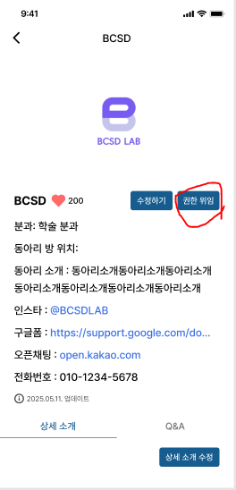
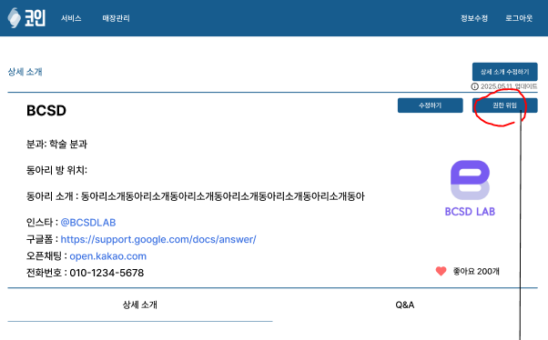

# 5-4.동아리_권한위임 클릭

[← 콜밴팟 로깅 목록](README.md)

플랫폼: ANDROID · IOS · WEB  
원문 상태: 완료

원문에 과거·새 로깅 구분이 없어 아래 정의와 참고사진을 원문 순서로 표시합니다.

원문 미기재 항목: `screen_view`. 값을 추정하지 않았습니다.

- 설명: 동아리 소개 화면에서 권한위임 버튼 클릭

- event\_name : “CAMPUS”

- event\_label : “club\_delegation\_authority”

- value : “권한위임”

- event\_category : “click” 

- 웹 참고사진

---

원문 정보

원본 ID: `d770221954bc831aafc60183b0ba49f7`  
[보존 원문](../../_archive/original/notion/pages/d770221954bc831aafc60183b0ba49f7.md)

