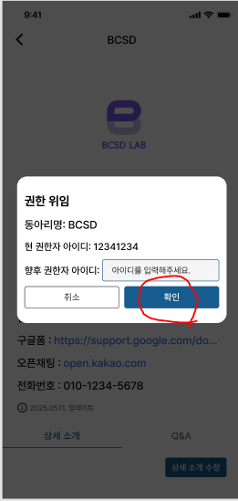
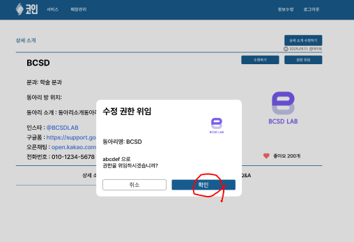

# 5-5.동아리_권한위임 확인

[← 콜밴팟 목록](README.md)

플랫폼: ANDROID, IOS, WEB  
원문 상태: 완료  
[Notion 기준 명세](https://app.notion.com/p/6fd0221954bc82a3ae0001ca81b572ac)  
원본 ID: `6fd0221954bc82a3ae0001ca81b572ac`

<!-- notion-body:start -->
- 설명: 권한위임 팝업에서 확인버튼 클릭

주의사항: 

- 모바일 - 확인을 눌렀는데 아이디를 기입하지 않아서 처리가 안된경우와 같이 권한위임 처리가 안된 경우는 제외.
- 웹 - 웹의 경우는 재확인 팝업창을 기준으로 로깅을 진행

---

- event\_name : “CAMPUS”
- event\_label : “club\_delegation\_authority\_confirm”
- value : “권한위임”
- event\_category : “click”
- 참고사진



- 웹 참고사진


<!-- notion-body:end -->

<details>
<summary>Notion 원문 속성 전체</summary>

```json
{
  "platform": [
    "ANDROID",
    "IOS",
    "WEB"
  ],
  "url": "https://app.notion.com/p/6fd0221954bc82a3ae0001ca81b572ac",
  "상태": "완료",
  "이름": "5-5.동아리\\_권한위임 확인"
}
```

</details>
