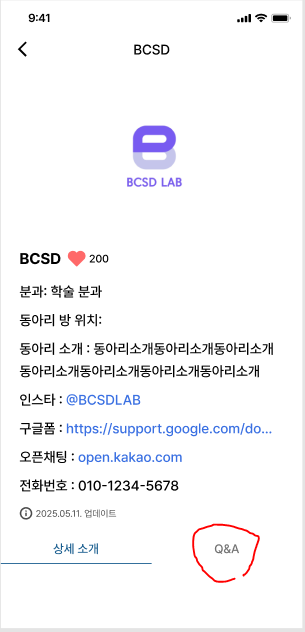
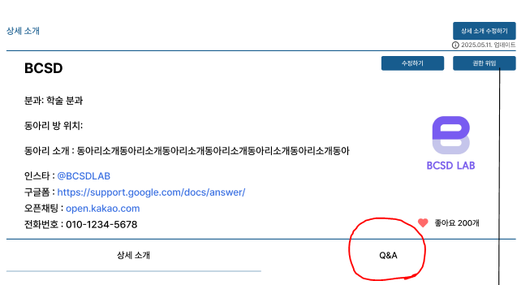

# 5-6.동아리_탭 클릭(추가사항)

[← 콜밴팟 로깅 목록](README.md)

플랫폼: ANDROID · IOS · WEB  
원문 상태: 로깅 필요

원문에 과거·새 로깅 구분이 없어 아래 정의와 참고사진을 원문 순서로 표시합니다.

원문 미기재 항목: `screen_view`. 값을 추정하지 않았습니다.

- 설명: 동아리 소개 화면에서 상세소개나 Q&A탭 클릭

클릭한 탭에 따라 value는 Q&A나 상세 소개로 부탁드립니다.

- event\_name : “CAMPUS”

- event\_label : “club\_tab\_select”

- value : \{”상세 소개”, “Q&A”, “모집”, “행사”\}

- event\_category : “click” 

- 참고사진

- 웹 참고사진

---

원문 정보

원본 ID: `b660221954bc82af8bb2814b7aa8574a`  
[보존 원문](../../_archive/original/notion/pages/b660221954bc82af8bb2814b7aa8574a.md)

