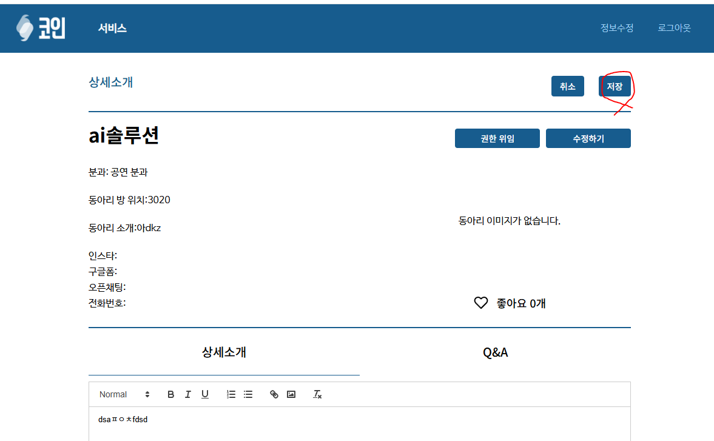
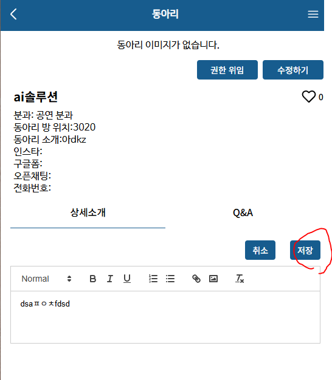

# 5-8.동아리_상세소개 수정하기_저장 클릭

[← 콜밴팟 로깅 목록](README.md)

플랫폼: WEB  
원문 상태: 완료

원문에 과거·새 로깅 구분이 없어 아래 정의와 참고사진을 원문 순서로 표시합니다.

원문 미기재 항목: `screen_view`. 값을 추정하지 않았습니다.

- 설명: 동아리 소개 화면 → 상세소개 수정하기를 누른후 → 저장 버튼 클릭

- event\_name : “CAMPUS”

- event\_label : “club\_introduction\_correction\_save”

- value : “저장”

- event\_category : “click” 

- 웹 참고사진

- 모바일 웹 뷰

---

원문 정보

원본 ID: `7ff0221954bc82ea91bd81710580f3f8`  
[보존 원문](../../_archive/original/notion/pages/7ff0221954bc82ea91bd81710580f3f8.md)

