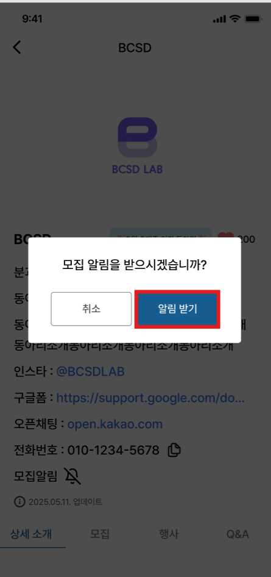

# 5.15동아리_모집알림 받기

[← 콜밴팟 목록](README.md)

플랫폼: ANDROID, IOS  
원문 상태: 로깅 필요  
[Notion 기준 명세](https://app.notion.com/p/ebc0221954bc83cfbd1701078774d54b)  
원본 ID: `ebc0221954bc83cfbd1701078774d54b`

<!-- notion-body:start -->
- 설명: 동아리 소개 화면에서 모집알림 버튼 클릭 후 알림 모달에서 알림 받기 클릭
- event\_name : “CAMPUS”
- event\_label : “club\_recruitment\_accept”
- value : \{동아리명\}
- event\_category : “click”
- 참고사진


<!-- notion-body:end -->

<details>
<summary>Notion 원문 속성 전체</summary>

```json
{
  "platform": [
    "ANDROID",
    "IOS"
  ],
  "url": "https://app.notion.com/p/ebc0221954bc83cfbd1701078774d54b",
  "상태": "로깅 필요",
  "이름": "5.15동아리\\_모집알림 받기"
}
```

</details>
