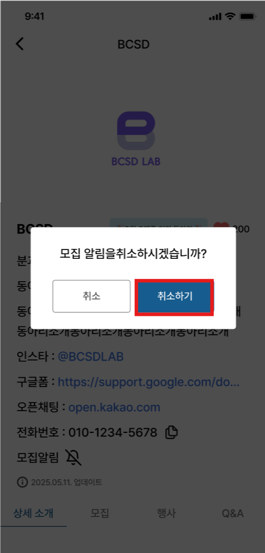

# 5.16동아리_모집알림 취소

[← 콜밴팟 로깅 목록](README.md)

플랫폼: ANDROID · IOS  
원문 상태: 로깅 필요

원문에 과거·새 로깅 구분이 없어 아래 정의와 참고사진을 원문 순서로 표시합니다.

원문 미기재 항목: `screen_view`. 값을 추정하지 않았습니다.

- 설명: 동아리 소개 화면에서 모집알림 버튼 클릭 후 알림 모달에서 취소하기 클릭

- event\_name : “CAMPUS”

- event\_label : “club\_recruitment\_cancel”

- value : \{동아리명\}

- event\_category : “click” 

- 참고사진

---

원문 정보

원본 ID: `fb60221954bc828fb321014976c860dd`  
[보존 원문](../../_archive/original/notion/pages/fb60221954bc828fb321014976c860dd.md)

