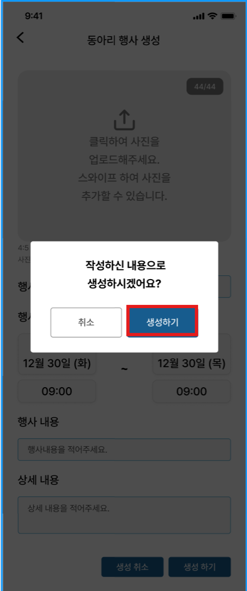
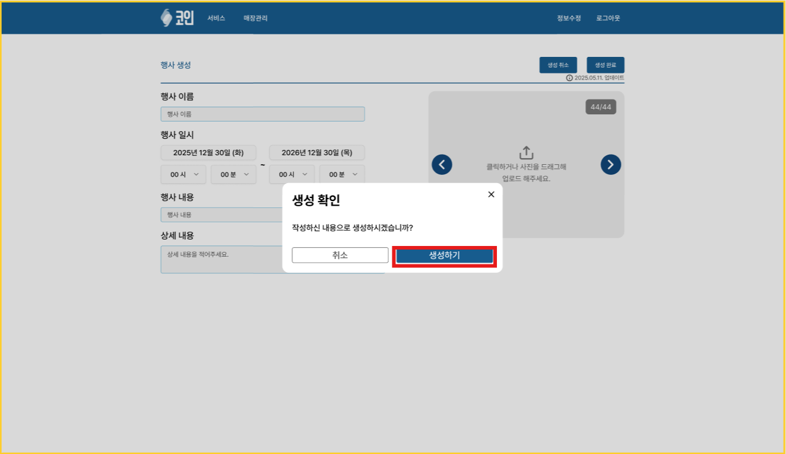

# 6.4동아리_행사생성확정 클릭

[← 콜밴팟 목록](README.md)

플랫폼: ANDROID, IOS, WEB  
원문 상태: 로깅 필요  
[Notion 기준 명세](https://app.notion.com/p/a300221954bc83178c1b81ca7c24ddff)  
원본 ID: `a300221954bc83178c1b81ca7c24ddff`

<!-- notion-body:start -->
- 설명: 동아리 행사 탭에서 행사 생성하기 클릭 후 생성 하기 클릭
- event\_name : “CAMPUS”
- event\_label : “club\_event\_confirm”
- value : \{동아리명\}
- event\_category : “click”
- 참고사진



- 웹 참고사진


<!-- notion-body:end -->

<details>
<summary>Notion 원문 속성 전체</summary>

```json
{
  "platform": [
    "ANDROID",
    "IOS",
    "WEB"
  ],
  "url": "https://app.notion.com/p/a300221954bc83178c1b81ca7c24ddff",
  "상태": "로깅 필요",
  "이름": "6.4동아리\\_행사생성확정 클릭"
}
```

</details>
