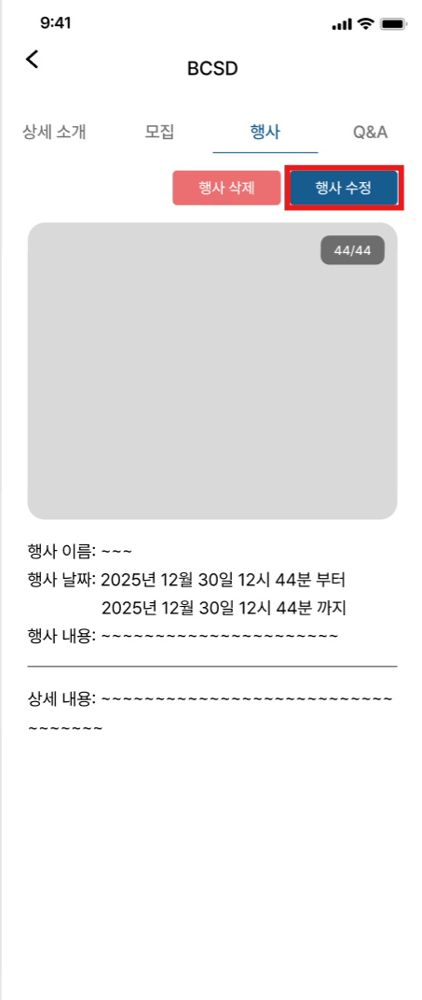
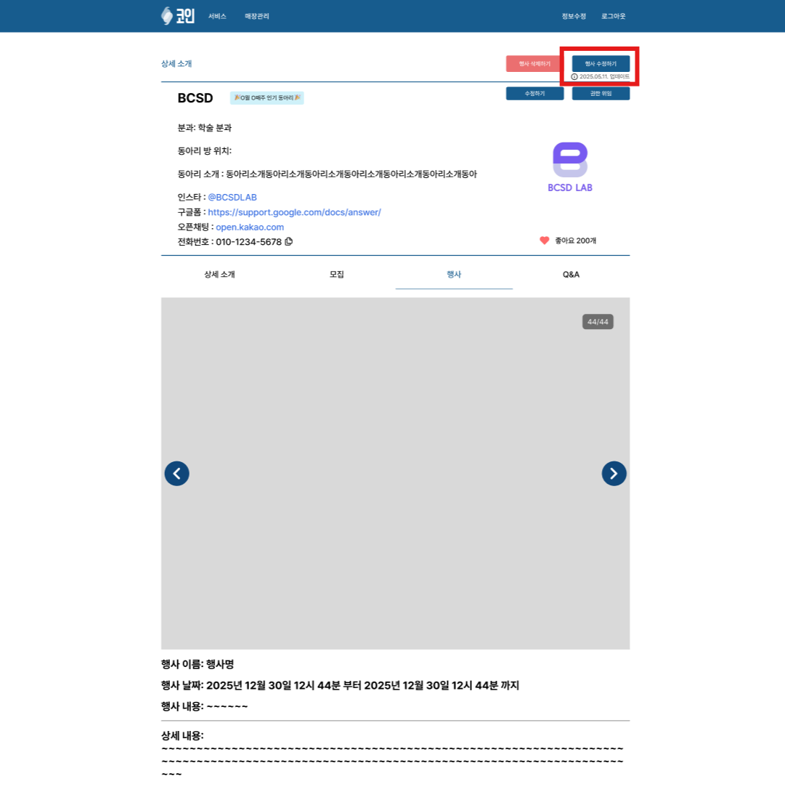

# 6.6동아리_행사수정 클릭

[← 콜밴팟 로깅 목록](README.md)

플랫폼: ANDROID · IOS · WEB  
원문 상태: 로깅 필요

원문에 과거·새 로깅 구분이 없어 아래 정의와 참고사진을 원문 순서로 표시합니다.

원문 미기재 항목: `screen_view`. 값을 추정하지 않았습니다.

- 설명: 동아리 행사 탭에서 행사 수정 클릭

- event\_name : “CAMPUS”

- event\_label : “club\_event\_correction”

- value : \{동아리명\}

- event\_category : “click” 

- 참고사진

- 웹 참고사진

---

원문 정보

원본 ID: `6730221954bc82c7ae9e81dbfe1e4052`  
[보존 원문](../../_archive/original/notion/pages/6730221954bc82c7ae9e81dbfe1e4052.md)

