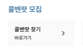
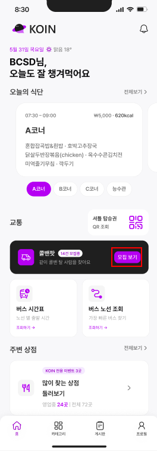

# [레거시] [레거시] 1-1 메인 → 콜밴팟 모집 보기

> **레거시 문서** · 과거 구현과 로깅을 확인하기 위한 보존 자료입니다.

[← 콜밴팟 로깅 목록](README.md)

플랫폼: ANDROID · IOS  
원문 상태: 레거시

과거 로깅·새 로깅과 각 참고사진은 원문의 구간별 연결을 유지합니다.

<callout icon="📁" color="gray_bg">
<b>레거시 보존 · 현행 기준은 홈화면 리디자인</b>

- 2026-11-05 사용자 지시: 홈화면 리디자인의 로깅은 모두 유지하고, 겹치는 다른 서비스 명세를 레거시로 보존한다.
- 메인 콜밴팟 모집보기의 현행 기준: [1-6 콜벤팟 모집 보기 클릭](../10-%ED%99%88%ED%99%94%EB%A9%B4-%EB%A6%AC%EB%94%94%EC%9E%90%EC%9D%B8/1-6-%EC%BD%9C%EB%B2%A4%ED%8C%9F-%EB%AA%A8%EC%A7%91-%EB%B3%B4%EA%B8%B0-%ED%81%B4%EB%A6%AD.md).
- 이 페이지는 별도 신규 구현·추가 전송 대상이 아니다. 아래 라벨·value·category·event\_name·screen\_view·사진·플랫폼과 이전 로깅은 이력으로 보존한다.
- 이전의 ‘이 페이지가 대표’·‘두 문서 별개 유지’·‘같은 라벨 문서 계약’ 설명은 이 최신 결정으로 대체한다. 홈 명세의 라벨·값·필드는 이번 작업에서 변경하지 않는다.
- 실제 SDK의 옛 라벨 중단·전환·단일 전송은 미확인이다. 이 문서 정리는 운영 코드나 데이터의 삭제·변경을 뜻하지 않는다.
</callout>

<!-- logging-section:past:start -->
## 이전 로깅

- event\_name : CAMPUS

- event\_category : click

- event\_label : main\_callvan\_view

- value : 

<!-- logging-section:past:end -->

<!-- logging-section:new:start -->
## 새 로깅 (2026-10-15)

- 설명: 리디자인된 메인의 교통 영역에서 콜밴팟 ‘모집 보기’를 클릭한다.
- screen\_view: <code>main</code>
- event\_label: <code>callvan__main__callvan_entry__recruitment_list_entry__click</code>
- event\_name: <code>DA2</code>
- event\_category: <code>click</code>
- value: 콜밴팟 모집보기

검토사항

- 코드·수집 대조 (2026-11-01): [iOS 메인 모집 보기 호출](https://github.com/BCSDLab/KOIN_iOS/blob/ea494b30ffa6197d62592369f7ae4265ced2e678/Koin/Presentation/Home/Home/HomeView.swift#L65-L74)은 이동 직전 value 콜밴팟 모집보기를 보낸다. 확인한 커밋은 callvanpot/CAMPUS를 사용한다. 10/25\~31 raw GA4에서 callvanpot 137건(Android 72·iOS 59·WEB 6), 새 label 0건이다. WEB 관측은 과거 수집 사실이며 이 명세의 WEB 제외 범위를 변경하지 않는다. 새 DA2 label·고정 main 화면명·실제 한 번 전송은 검증 대기다.
- 동일 이벤트 문서 계약 (2026-11-01): 사용자 승인으로 새 value를 “콜밴팟 모집보기”로 통일한다. 기준 명세는 [[레거시] 1-1 메인 → 콜밴팟 모집 보기](4010221954bc82648a3f814f7273bcfc.md), 대응 명세는 [1-6 콜벤팟 모집 보기 클릭](../10-%ED%99%88%ED%99%94%EB%A9%B4-%EB%A6%AC%EB%94%94%EC%9E%90%EC%9D%B8/1-6-%EC%BD%9C%EB%B2%A4%ED%8C%9F-%EB%AA%A8%EC%A7%91-%EB%B3%B4%EA%B8%B0-%ED%81%B4%EB%A6%AD.md)다. 메인 교통 영역의 모집 보기 클릭 한 번에 문서 수만큼 추가·중복 전송하지 않는다. 기존 label·screen\_view·event\_name·category·플랫폼과 이전 로깅은 유지한다. 실제 호출 지점·플랫폼별 SDK 전송값·한 번 전송은 미확인이다.
- 통합 가이드·후속: 원문 (원문 ID: 4129ae650b598060bb4bdf347b7d4c7a)
- 변경 대응: 이전 메인의 ‘콜밴팟 찾기’ 진입을 현재 ‘모집 보기’ 진입으로 교체한다. 이전 UI 사진은 이전 로깅에 보존한다.
- 대응 로깅 위치: [홈화면 리디자인](../../_archive/original/notion/pages/f1b0221954bc8342bd9781c149b826b0.md)의 [1-6 콜벤팟 모집 보기 클릭](../10-%ED%99%88%ED%99%94%EB%A9%B4-%EB%A6%AC%EB%94%94%EC%9E%90%EC%9D%B8/1-6-%EC%BD%9C%EB%B2%A4%ED%8C%9F-%EB%AA%A8%EC%A7%91-%EB%B3%B4%EA%B8%B0-%ED%81%B4%EB%A6%AD.md). 콜밴팟 문서의 1-6을 뜻하지 않는다.
- label 통일 (2026-10-27): callvan\_\_main\_\_callvan\_entry\_\_recruitment\_list\_entry → callvan\_\_main\_\_callvan\_entry\_\_recruitment\_list\_entry\_\_click
- 중복 방지: 1-1과 홈화면 리디자인 1-6은 동일한 현행 진입 기능의 대응 명세다. 한 번의 클릭에 두 이벤트를 새로 추가하는 요청이 아님.

참고사진 · 모바일

리디자인 메인에 제공된 기존 캡처. 빨간 박스는 교통 영역의 ‘모집 보기’. 이번 작업에서 실제 Android를 새로 캡처한 자료는 아님.

<!-- logging-section:new:end -->

---

원문 정보

원본 ID: `4010221954bc82648a3f814f7273bcfc`  
[보존 원문](../../_archive/original/notion/pages/4010221954bc82648a3f814f7273bcfc.md)

