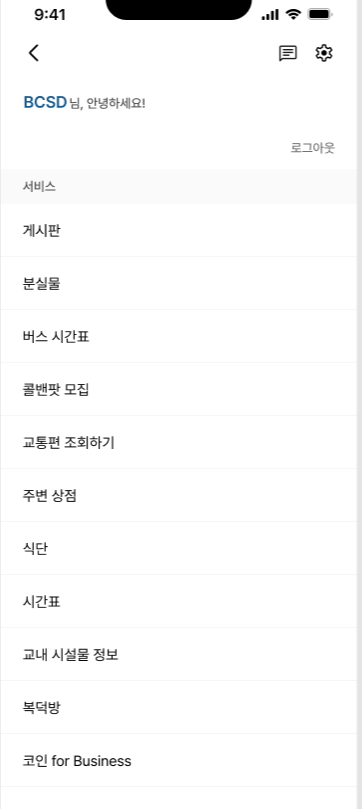
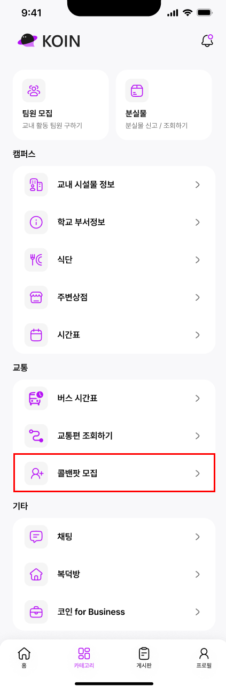

# [레거시] [레거시] 1-3 카테고리 → 콜밴팟 모집

> **레거시 문서** · 과거 구현과 로깅을 확인하기 위한 보존 자료입니다.

[← 콜밴팟 로깅 목록](README.md)

플랫폼: ANDROID · IOS  
원문 상태: 로깅 필요

과거 로깅·새 로깅과 각 참고사진은 원문의 구간별 연결을 유지합니다.

원문 미기재 항목: `screen_view`. 값을 추정하지 않았습니다.

<!-- logging-section:past:start -->
## 과거 로깅

- event\_name : CAMPUS
- event\_category : click
- event\_label : hamburger
- value : 콜밴팟 모집

- 레거시 전환 (2026-11-01 사용자 지시): 이 1-3 명세는 삭제하지 않고 과거 이력으로 보존한다. 현행 카테고리 콜밴팟 클릭은 홈 3-6 [3-6 카테고리 내부 클릭 (현재 로깅) 2026.08.30 이후 찍히는 로깅](../10-%ED%99%88%ED%99%94%EB%A9%B4-%EB%A6%AC%EB%94%94%EC%9E%90%EC%9D%B8/3-6-%EC%B9%B4%ED%85%8C%EA%B3%A0%EB%A6%AC-%EB%82%B4%EB%B6%80-%ED%81%B4%EB%A6%AD-%28%ED%98%84%EC%9E%AC-%EB%A1%9C%EA%B9%85%29-2026.08.30-%EC%9D%B4%ED%9B%84-%EC%B0%8D%ED%9E%88%EB%8A%94-%EB%A1%9C%EA%B9%85.md)을 참조한다. 아래 라벨·value·사진·이전 로깅은 보존용이며 별도 신규 구현·추가 전송 대상으로 삼지 않는다. 실제 SDK 전송·기존 이벤트 중단 여부는 별도 확인이 필요하다.

### 참고사진 (기능 표시)

#### 모바일

화면 정의에 제공된 카테고리 캡처. 해당 메뉴의 위치에 빨간 테두리만 추가. 이번 작업의 실제 Android 신규 캡처가 아님.

<!-- logging-section:past:end -->

<!-- logging-section:new:start -->
## 새 로깅

레거시.

<!-- logging-section:new:end -->

---

원문 정보

원본 ID: `da10221954bc82468691018b7178825f`  
[보존 원문](../../_archive/original/notion/pages/da10221954bc82468691018b7178825f.md)

