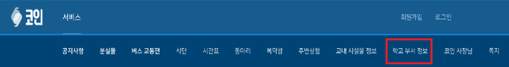
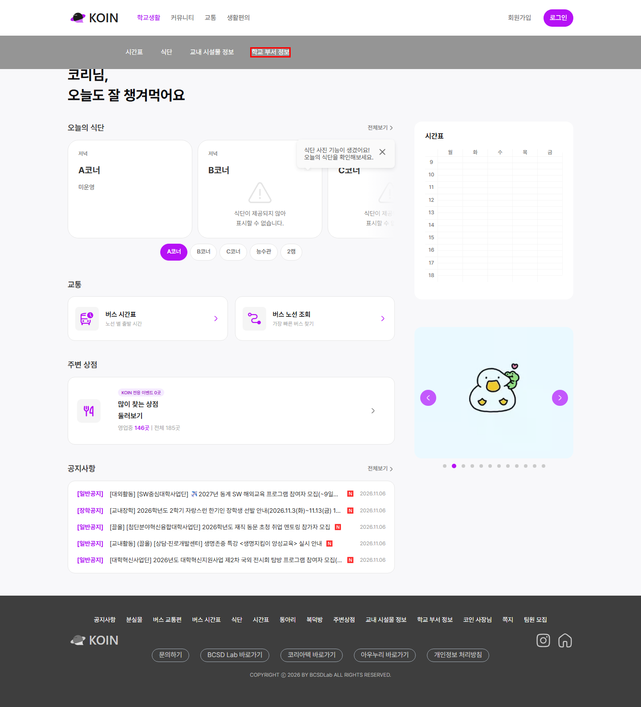

# 1-0 학교 부서 정보 접근 (헤더 진입)

[← 학교 부서 정보 로깅 목록](README.md)

플랫폼: WEB  
원문 상태: 완료

과거 로깅·새 로깅과 각 참고사진은 원문의 구간별 연결을 유지합니다.

<!-- logging-section:past:start -->
## 과거 로깅

팀 : CAMPUS 

나머지 로깅들도 전부 CAMPUS로 해주세요\~\~

- event\_label : header
- value : 학교 부서 정보
- event\_category : click

<!-- logging-section:past:end -->

<!-- logging-section:new:start -->
## 새 로깅

- 구체적 발생 조건: WEB 리디자인의 상단 ‘학교생활’ 서브 내비게이션에서 ‘학교 부서 정보’를 클릭한다. 상위 메뉴를 여는 동작은 포함하지 않는다.
- screen\_view: <code>header</code>
- event\_label: <code>department__header__department_entry__header_entry__click</code>
- event\_name: <code>DA2</code>
- event\_category: <code>click</code>
- value: 학교 부서 정보

### 참고사진 (기능 표시)

<b>웹(데스크톱)</b>

<b>참고사진 · 웹 (Stage 실제 화면)</b>

2026-11-08 [Stage 실제 서비스](https://stage.koreatech.in/) · PC 1440px 브라우저에서 직접 촬영했다. 빨간 테두리는 이 명세의 해당 버튼 위치다. 현재 WEB 위치는 이 실제 캡처를 우선한다. 모바일 이미지·로깅 필드·DB 플랫폼은 유지하며 SDK 전송·GA4 수집 검수 완료를 뜻하지 않는다.

<!-- logging-section:new:end -->

---

원문 정보

원본 ID: `4d30221954bc8348a42801371514887e`  
[보존 원문](../../_archive/original/notion/pages/4d30221954bc8348a42801371514887e.md)

