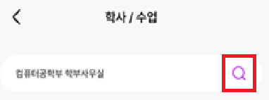
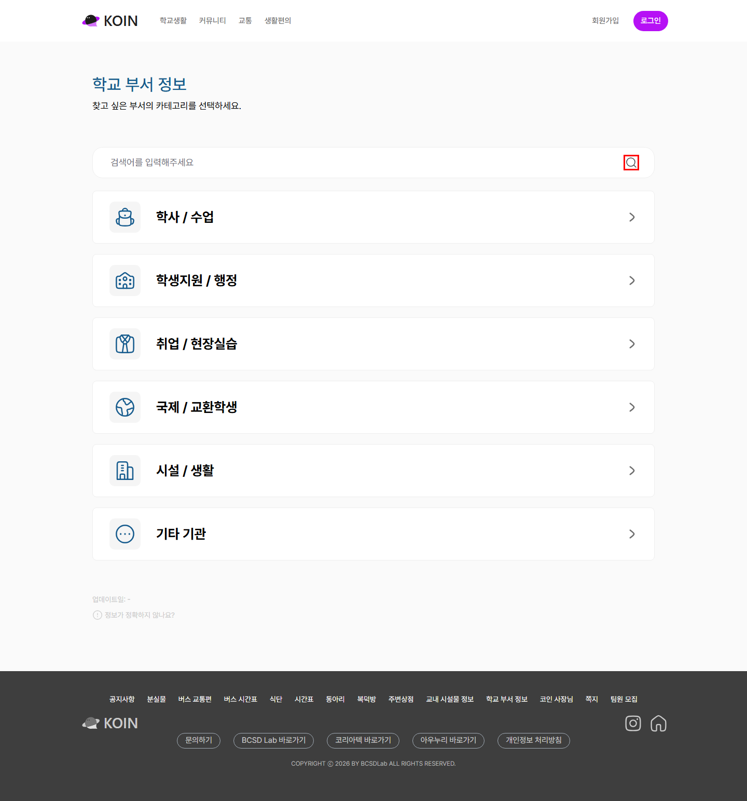
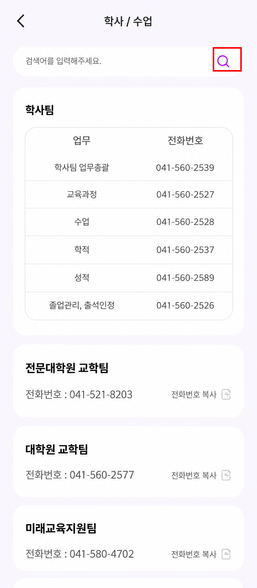

# 1-2 검색 아이콘 쿨릭

[← 학교 부서 정보 로깅 목록](README.md)

플랫폼: ANDROID · IOS · WEB  
원문 상태: 완료

과거 로깅·새 로깅과 각 참고사진은 원문의 구간별 연결을 유지합니다.

<!-- logging-section:past:start -->
## 과거 로깅

- event\_label : department\_search
- value : \{컴퓨터공학부 학부사무실\} or \{학생지원팀\} or \{기계공학부\} 등등 (사용자가 입력한대로 나오게 부탁드립니다.)
- event\_category : click

<!-- logging-section:past:end -->

<!-- logging-section:new:start -->
## 새 로깅

<b>분류 화면 — WEB 확인 사례</b>

- 설명: 부서 분류 화면에서 검색 아이콘을 클릭하거나 Enter로 검색을 실행하는 순간 입력한 검색어를 전송한다.
- screen\_view: <code>department_main</code>
- event\_label: <code>department__department_main__search__click</code>

<b>목록 화면 — mobile (ANDROID, IOS) 확인 사례</b>

- 설명: 부서 목록 화면에서 검색 아이콘을 클릭하거나 Enter로 검색을 실행하는 순간 입력한 검색어를 전송한다.
- screen\_view: <code>department_list</code>
- event\_label: <code>department__department_list__search__click</code>
- event\_name: <code>DA2</code>
- value: \{컴퓨터공학부 학부사무실\} or \{학생지원팀\} or \{기계공학부\} 등등 (사용자가 입력한대로 나오게 부탁드립니다.)
- event\_category: <code>click</code>
- 발생 시점 확정: 검색 아이콘 클릭 또는 Enter 검색 실행 시 입력한 검색어를 value에 저장한다. 결과가 표시되는 시점의 이벤트와 구분한다. 두 실행 방식 모두 기존 승인 category click을 유지하며, 현행 label은 <code>department__department_main__search__click</code> / <code>department__department_list__search__click</code>이다. 검색창이 확인된 플랫폼별 고정 화면 사례만 사용한다.

### 참고사진 (기능 표시)

<b>웹(데스크톱)</b>

#### 웹 (Stage 실제 화면)

2026-11-08 [Stage 실제 서비스](https://stage.koreatech.in/department) · PC 1440px 브라우저에서 직접 촬영했다. 빨간 테두리는 이 명세의 해당 버튼 위치다. 현재 WEB 위치는 이 실제 캡처를 우선한다. 모바일 이미지·로깅 필드·DB 플랫폼은 유지하며 SDK 전송·GA4 수집 검수 완료를 뜻하지 않는다.

#### 모바일

화면 정의의 Android 실제 캡처(2026-10-13), 선명도 개선본. 목록 화면 검색 아이콘. 검색 결과 실제 화면은 사용자 확인 완료(2026-10-16). 기존 고정 화면명과 검색 실행 시점을 유지한다.

<!-- logging-section:new:end -->

---

원문 정보

원본 ID: `1c90221954bc83e296218156a8d9b0d6`  
[보존 원문](../../_archive/original/notion/pages/1c90221954bc83e296218156a8d9b0d6.md)

