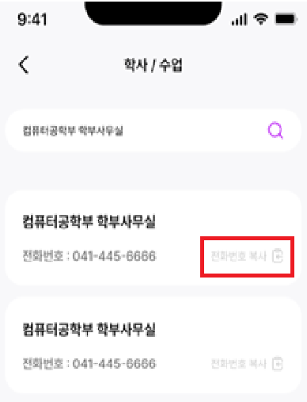
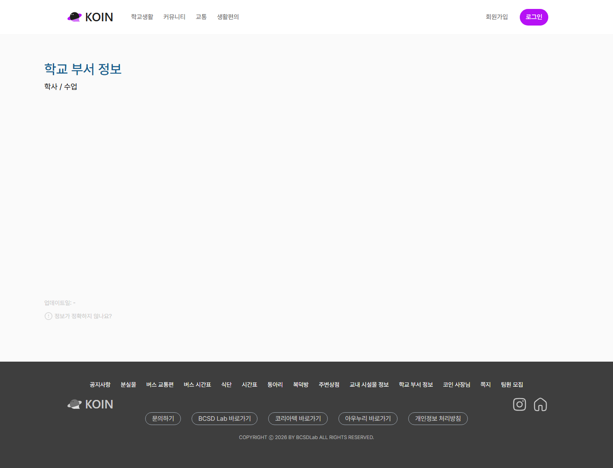
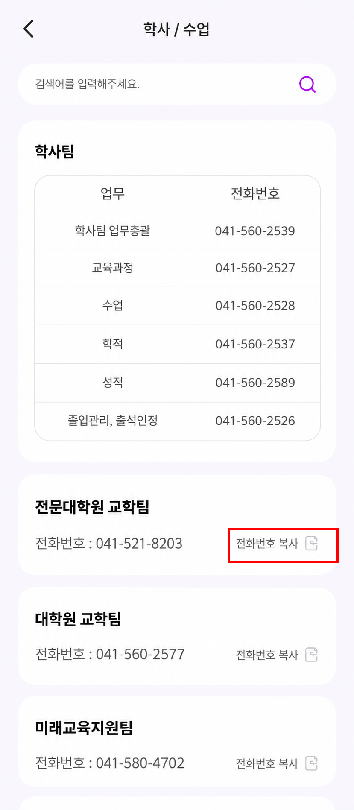

# 1-3 전화번호 복사

[← 학교 부서 정보 목록](README.md)

플랫폼: ANDROID, IOS, WEB  
원문 상태: 완료  
[Notion 기준 명세](https://app.notion.com/p/a840221954bc835380df814bc5b3dc42)  
원본 ID: `a840221954bc835380df814bc5b3dc42`

<!-- notion-body:start -->
## 과거 로깅

- event\_label : department\_contact\_copy
- value : 전화번호 복사
- event\_category : click



## 새 로깅

<b>분류별 부서 목록</b>

- 설명: 부서 목록 카드에서 전화번호 복사 버튼을 클릭한다.
- screen\_view: <code>department_list</code>
- event\_label: <code>department__department_list__contact__phone_copy__click</code>

<b>WEB 검색 결과</b>

- 설명: 분류 화면의 페이지 내 검색 결과 카드에서 전화번호 복사를 클릭한다.
- screen\_view: <code>department_main</code>
- event\_label: <code>department__department_main__contact__phone_copy__click</code>
- event\_name: <code>DA2</code>
- value: 전화번호 복사
- event\_category: <code>click</code>

### 참고사진 (기능 표시)

<b>웹(데스크톱)</b>

<b>참고사진 · 웹 (Stage 실제 화면)</b>

2026-11-08 [Stage 실제 서비스](https://stage.koreatech.in/department) · PC 1440px 브라우저에서 직접 촬영했다. 학사 / 수업 상세 화면에 부서 목록·전화번호·복사 버튼이 표시되지 않아 실제 복사 위치는 확인하지 못했다. 빨간 테두리를 임의로 만들지 않았으며 아래 Figma 시안을 실제 배포 화면의 근거로 사용하지 않는다. 기능 삭제나 수집 장애 원인을 확정한 것은 아니다. 현재 WEB 위치는 이 실제 캡처를 우선한다. 모바일 이미지·로깅 필드·DB 플랫폼은 유지하며 SDK 전송·GA4 수집 검수 완료를 뜻하지 않는다.



<b>모바일 (ANDROID, IOS) / 캡처 출처는 아래 참조</b>

<b>참고사진 · 모바일</b>

화면 정의의 Android 실제 캡처(2026-10-13), 선명도 개선본. 이번 작업은 기존 캡처를 사용.


<!-- notion-body:end -->

<details>
<summary>Notion 원문 속성 전체</summary>

```json
{
  "platform": [
    "ANDROID",
    "IOS",
    "WEB"
  ],
  "url": "https://app.notion.com/p/a840221954bc835380df814bc5b3dc42",
  "구분": "학교 부서정보",
  "상태": "완료",
  "생성일": "2026-11-23T13:38:53.833Z",
  "이벤트 이름": "1-3 전화번호 복사"
}
```

</details>
